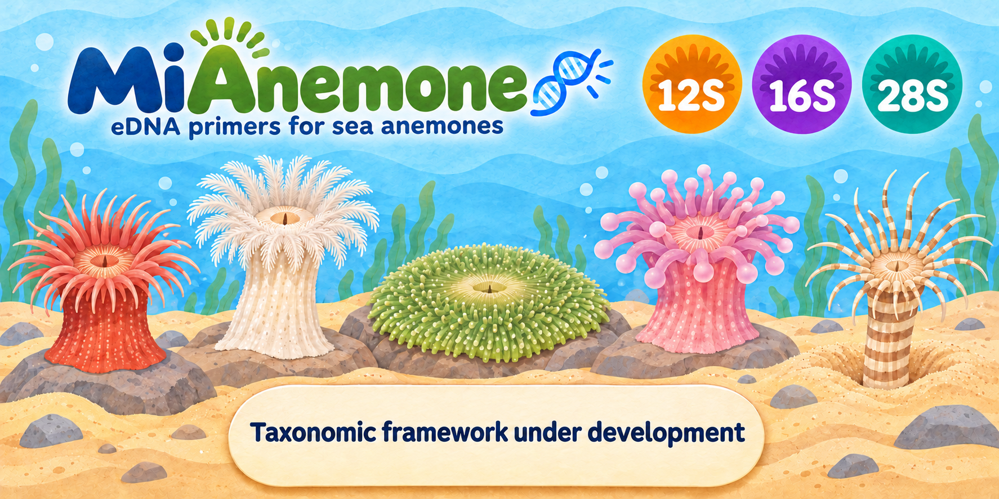
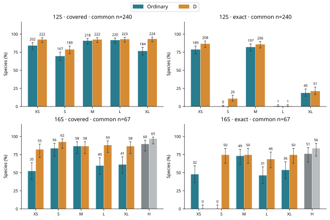
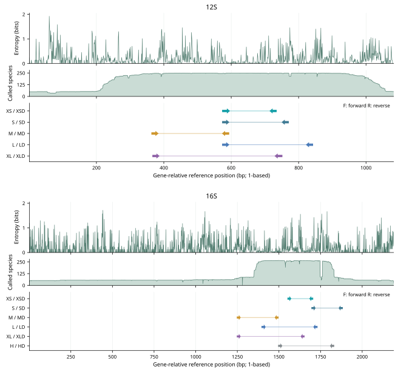
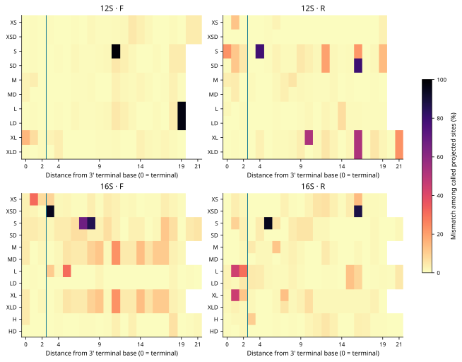
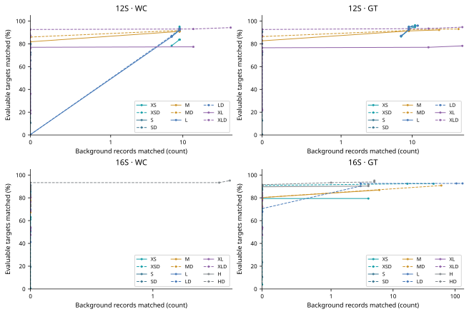
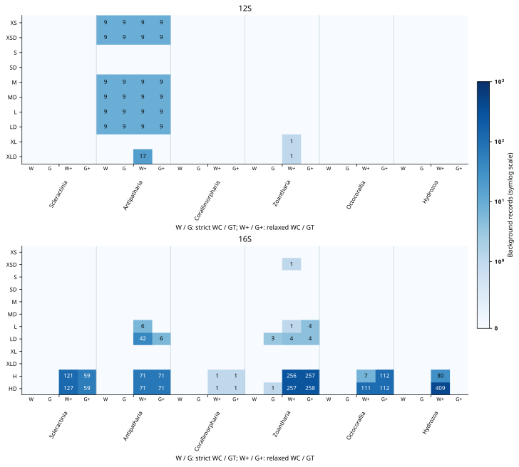
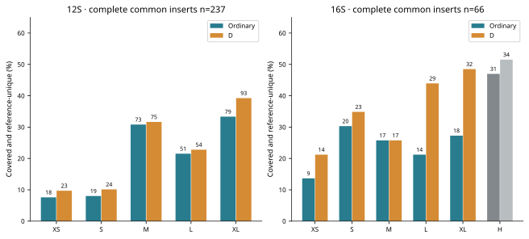

# MiAnemone: in silico design and evaluation of mitochondrial 12S and 16S rRNA primers for sea anemone (Actiniaria) eDNA metabarcoding

**Fei Xia**

<!-- publication:start -->
**Preprint v1.4 · 4 November 2026 · Not peer reviewed.**

[PDF](publications/MiAnemone_preprint.pdf) · [Manuscript](publications/MiAnemone_preprint.md) · [Versioned release](https://github.com/GUIBA-EX/MiAnemone/releases/tag/preprint-v1.4) · [CITATION.cff](CITATION.cff) · [BibTeX](CITATION.bib) · [Build and updates](publications/README.md)
<!-- publication:end -->

Computational preprint · 4 November 2026 · Revision 2

[中文](README.md) · [Revision PDF](publications/MiAnemone_preprint.pdf) · [Response to review](publications/response_to_review.md) · [Reproduction guide](revision/README.md)

## Start here

| Intended use | Priority |
| --- | --- |
| Short fragments | 12S XSD |
| Matching and reference discrimination | 12S MD |
| Broader target coverage | 16S LD |

[Primer sequences](primers.fasta) · [Nucleotide matching](figures/12S_base_matching.svg) · [PDF](publications/MiAnemone_preprint.pdf)

## Abstract

Sea-anemone environmental DNA surveys require primers that accommodate target variation while retaining informative barcode regions. We evaluated 22 ordinary and degenerate primer pairs across five mitochondrial 12S and 16S rRNA windows and an additional manually designed 16S site. Reference panels contained 250 and 265 named species, respectively. Paired matching, common-species comparisons, multi-record analyses and genus-blocked reselection at fixed windows assessed compatibility and reference discrimination. The adopted 12S XSD covered 227 of 245 evaluable species and exactly matched 212, with nine strict background hits. Factorial controls showed that fixed-base substitutions, rather than degeneracy itself, explained the preceding candidate's loss of exact matching. Common coverage panels contained 240 species for 12S and 67 for 16S, highlighting differences in reference availability among windows. Reference uniqueness depended on barcode location as well as length. The results prioritize 12S XSD for short-fragment studies, 12S MD for matching and reference discrimination, and 16S LD for broader target coverage where relaxed background matching is acceptable. These computational comparisons provide a basis for selecting assays according to target taxa and required resolution.

**Keywords:** Actiniaria; environmental DNA; mitochondrial rRNA; degenerate primers; reference databases; in silico PCR

## Introduction

Actiniaria comprises a diverse assemblage of benthic anthozoans whose detection and identification can be difficult from fragmented, cryptic or inaccessible specimens. Rodríguez et al. (2014) recognized approximately 1,200 described species and reorganized the order into Anenthemonae and Enthemonae using molecular evidence that included mitochondrial 12S and 16S. Environmental DNA offers a complementary route to surveying this diversity, but a candidate assay must solve two distinct problems: compatible primer-binding sites and a taxonomically informative barcode.

MiFish illustrates the use of conserved flanks around an informative mitochondrial region (Miya et al., 2015). Anth-28S instead uses degenerate nuclear-ribosomal primers to accommodate anthozoan variation (McCartin et al., 2024). Neither principle guarantees that an analogous mitochondrial assay will distinguish sea-anemone species. Slow mitochondrial sequence evolution in Anthozoa is well documented (Shearer et al., 2002; Hellberg, 2006), and shared mitochondrial sequences can limit assignment even when primer compatibility is high.

Mismatch-tolerant coverage also differs from exact matching. Experimental metabarcoding studies show that primer mismatches can influence amplification bias (Piñol et al., 2015), but their effects depend on position and reaction conditions. We use mismatch reduction to quantify sequence compatibility. Following the comparative approach illustrated by Bae (2025), this study evaluates binding-site compatibility, background matching and barcode discrimination separately. We ask how these assessments change after controlling the species panel, separating degeneracy from fixed-base substitutions, and testing additional records and withheld genera.

## Materials and methods

### Data acquisition and reference curation

The archived GenBank searches retrieved 1,360 records for 12S and 2,527 for 16S. The complete search expressions and accession-level decisions are distributed with the frozen input archives. Searches combined Actiniaria with marker names and mitochondrial-genome terms. Annotated rRNA features were preferred; restricted title-based extraction accommodated unannotated marker fragments. The initial eligible pools contained 786 and 1,245 records, respectively. GenBank organism names and lineages were retained. Records labelled sp., cf. or other non-binomial names were excluded from the named-species design panels. These names were not independently reconciled against WoRMS, and voucher identifications were not revalidated; named-species counts consequently describe the archived GenBank labels.

One reference was retained per named species. For 12S, ranking used the number of called A/C/G/T bases, rRNA annotation, RefSeq status and accession as successive tie-breakers. Complete-genome status was not used in the 12S ranking. For 16S, ranking prioritized genome-supported completeness, called reference columns, called sequence length, low ambiguity, feature-based extraction, RefSeq status and accession. The resulting design panels contained 250 12S species and 265 16S species. Relative to the approximate diversity reported in 2014, these are about one fifth of described Actiniaria, not comprehensive inventories of the order.

The original background panels comprised 322 other cnidarian species for 12S and 1,775 other cnidarian records for 16S. Their numerical units differ; we retain explicit record and species labels and do not compare raw hit counts across markers as specificity estimates. Background results describe these cnidarian panels.

### Alignment and reference coordinates

MAFFT (Katoh & Standley, 2013) was run with `--adjustdirection --retree 2 --maxiterate 0 --thread 4`. The alignment used nucleotide sequence similarity. Binding-site coordinates are one-based and inclusive on the ungapped genes of *Metridium senile* NC_000933.1. The reference 12S feature occupies mitochondrial positions 12,201–13,282 and the 16S feature positions 72–2,260, both on the positive strand. We use 12S and 16S throughout for mitochondrial small- and large-subunit rRNA, respectively.

A sequence was evaluable at a window when its alignment spanned both binding regions and those regions contained no ambiguous nucleotide codes; alignment gaps were allowed. This criterion determines the denominator. Paired raw-sequence scanning then determines whether a product is predicted. A complete homologous binding motif is a stricter subset: after removing alignment gaps, each binding segment must have the primer length and contain only A/C/G/T. Thus evaluability and membership in the motif-frequency calculation need not coincide.

### Initial candidate generation and selection

The original search examined reference start positions at three-base increments and oligo lengths of 20 or 22 nt. At least ten species, or 10% of the target panel if greater, had to provide complete motifs. Candidate ordinary oligos comprised the position-wise consensus and frequent observed motifs. Degenerate alternatives added bases supported by at least 4% of complete motifs in the 3′ half, with at most eight sequence variants per end. Oligos were ranked by compatible-species count, then exact-species count, then lower degeneracy. The search retained a small ranked subset at each start position; it was a heuristic search, not an exhaustive proof of optimality.

Candidate pairs spanned 150–470 reference bases. Coordinate bins of 25 bp retained spatially diverse candidates, and successive size bands defined XS, S, M, L and XL. Raw target and background screening determined the selected windows. Within each selected window, observed motifs and a consensus were reconsidered. Degenerate candidates were built from up to 12 high-ranking ordinary seeds by merging compatible motifs sharing the same 5′ half for up to three rounds. Up to six ordinary and six degenerate candidates per end entered paired screening. Ordinary and D pairs were selected separately at identical endpoints. H denotes the hand-designed 16S site; H and HD are revised sequences at that site, retained as comparators rather than preferred assays.

Terminal filters rejected oligos capable of a homopolymer of five bases or a homogeneous terminal triplet, required at least one assured G/C among the final three positions, and limited possible G/C content in the final five positions. There was no additional global GC-percentage gate. A degenerate terminal base was permitted when all other constraints were met; compatibility means that at least one concrete variant supplies a matching terminus. This permits terminal variants while diluting the concentration of each matching oligo.

Thermodynamic filtering used Primer3 (Untergasser et al., 2012) through primer3-py 2.4.0 with 50 mM monovalent salt, 1.5 mM divalent salt and 0.6 mM dNTP. Nearest-neighbor Tm calculations used the SantaLucia parameter and salt-correction defaults (SantaLucia, 1998). Scenarios were 50 nM per concrete variant and 200 nM per direction divided equally among variants. The latter gives 25 nM per variant at degeneracy eight. Minimum variant Tm was 45°C, maximum modeled secondary-structure Tm was below 55°C, and the initial allowed F/R difference was 5°C. These thresholds defined candidate screening. Oligo properties and both concentration scenarios are reported in the supplementary table.

The initial ranking and thermodynamic gates can retain non-consensus bases. In particular, candidates were truncated before all paired combinations were examined, and a fixed temperature-difference threshold can exclude a consensus pair. This explains why shared conserved sites can have different selected bases; it is not evidence that each selected sequence is a universal consensus. The revision therefore audits every position, reports rejected alternatives, and tests training-only reselection rather than interpreting the initial winner as a global optimum.

### Matching models and continuous mismatch diagnostics

Coverage denotes a paired hit with at most two mismatches per end and zero mismatches in each terminal three nucleotides. Exact matching denotes zero mismatches at both ends; for D oligos, any concrete forward variant and any concrete reverse variant may supply that match. A species contributes once even if it has multiple compatible products. Both DNA orientations are scanned. Uncalled bases at a binding site do not count as matches.

In the original target analysis, a product had to span 100–500 bp with at least 50 internal bases. Original background screening allowed 0–1,000 internal bases to search more broadly for potential off-target products. Strict WC and GT models used two mismatches plus the terminal-triplet rule. Relaxed WC allowed three mismatches without the terminal restriction; relaxed GT allowed two. The GT model additionally accepts primer G against template A and primer T against template C in primer-oriented sequences, representing the corresponding wobble pairings on the opposite strand. These accepted pairings are also exempt from the terminal mismatch count in the GT model.

For direct sensitivity–background comparisons, the revision applies identical 100–500 bp and ≥50 internal-base geometry to target and background, WC and GT compatibility, zero to four mismatches per end, and zero, three or five protected terminal bases. Mismatch positions are recorded as distance from the terminal base, with distance zero at the 3′ end. An exploratory positional penalty sums `1 + 4 exp(-d/3)` over mismatches at both ends. This exploratory score summarizes proximity to the terminus. Accession-level scores are supplied in `revision/positional_penalties.csv`.

Background selection limits of ten strict and 50 relaxed hits were heuristic tolerances on the original panels. They do not represent a false-positive rate. H/HD exceeded the relaxed limits and are retained to show why strict matches alone are insufficient for assay choice. No 500-hit truncation was applied: the original values of 500 and 501 are actual record counts under that model and geometry.

### Consensus revisions and factorial controls

Before the XSD replacement, every one of the 912 positions across all 44 oligos, including D oligos, was audited against complete binding motifs. Replacements were tested when an excluded template base was more frequent than every base already represented at that position. Single substitutions and combinations within pairs produced 23 alternatives after the adopted XS G10A change. We tracked gained and lost species, all four original background models, terminal filters and thermodynamics.

The exception allowing a temperature difference up to 6°C for G10A was formulated after inspecting that candidate.  Its criteria were a nonterminal substitution, new-base frequency ≥90%, exact-match gain ≥10 percentage points, retention of every previously covered species and no added background record. We now expose sensitivity to temperature limits of 4, 5, 6 and 7°C and frequency limits of 80%, 85%, 90% and 95%. The threshold grid quantifies the sensitivity of candidate selection.

Three ordinary/D pairs in the preceding candidate set were non-nested. For each, we constructed a 2 × 2 control: ordinary sequence, fixed-base changes alone, degeneracy changes alone, and both changes. The degeneracy-only state nests the ordinary oligos. Controls were evaluated separately against terminal and thermodynamic filters. Fixed endpoints alone isolate location, not the biochemical effect of degeneracy when fixed bases also change.

### Common panels, additional records and genus-blocked reselection

Coverage and exact matching were recomputed on the intersection of evaluable species across all windows of each marker, including H for 16S. Wilson (1927) intervals describe binomial uncertainty conditional on these panels; GenBank species are not a random sample of Actiniaria. Ordinary-only and D-only species counts are reported in `revision/nesting.csv`.

The frozen archives supplied 694 named-species 12S records and 1,116 named-species 16S records. We aligned each expanded pool and reported any-record, strict-majority-record and all-record matching among evaluable records for each species. Complete records with different binding motifs flag observed within-species variability. Expanded alignments can change evaluability, so this analysis combines record and alignment sensitivity rather than estimating a pure replicate-record effect.

Five genus blocks were assigned deterministically by SHA-256 of the genus name modulo five. In each fold, ordinary and D candidates were regenerated using only training genera at the fixed published endpoints, with the same motif-generation and thermodynamic gates. Candidate selection maximized training coverage, exact matching and lower degeneracy. The background panel was not used to tune these diagnostic candidates. Withheld genera were scored by raw paired scanning. This tests sequence reselection conditional on endpoints and an alignment derived from the complete panel.

### Reference discrimination and assay compatibility

Primer-binding regions were removed before barcode comparison. Own-panel reference uniqueness and common-panel uniqueness were calculated separately. For the latter, all windows used the same species with complete unambiguous internal sequences. A joint metric counted species both predicted to amplify and unique within the corresponding reference panel. It describes the sampled reference library, not assured species identification in nature.

Nearest-neighbor differences were calculated as global unit-cost edit distance, including substitutions and indels. We report distance classes zero, one, two and at least three, and whether identical inserts are confined to a genus or family. Leave-one-reference nearest-neighbor assignments are counted correct only when all equally nearest references share the query's taxon. With one record per species, leave-one-reference species classification is not estimable. The expanded multi-record analysis instead reports observed maximum within-species distance, minimum between-species distance, and strict leave-one-record species assignment. A positive observed gap requires the former to be smaller than the latter and at least two records for that species.

Cross-assay heterodimers were screened across concrete variants of all pairs within each marker at 50 nM per variant under the same salt assumptions. Product-length summaries include each distinct accession–product-length combination and report potential ≥20-bp overlap for nominal paired reads of 150, 250 or 300 bases. These estimates precede quality and adapter trimming. Actual adapter sequences remain unspecified, so no adapter-bearing structure result is reported.

### Independent implementation checks

A Python seed-and-extension scanner and an independent C++ exhaustive all-window scanner checked the original frozen-panel outputs. The original 8,940 and 45,780 comparisons combine one target model with two background model families; each background family checks its strict and relaxed flags together. The new equal-geometry comparison checked 57,584 evaluable-record/model combinations at k = 2 and terminal protection of three bases, with no discrepancies. Agreement supports computational reproducibility on the frozen inputs.

## Results

### Equal-denominator comparisons change the interpretation of window coverage

The common coverage panels contained 240 12S species and only 67 16S species. The latter is much smaller than the 258–262 species evaluable at the 16S L and XS windows. Percentages calculated on the original window-specific panels therefore should not be ranked as if they represented the same taxa. On the common 16S panel, SD covered 62/67, LD 59/67, and MD and XLD each 58/67. HD covered 65/67 but has substantial relaxed background matching. Table 2 presents the original denominators together with common-panel counts and insert discrimination.

**Figure 1.** Covered and exact species on the same evaluable panel within each marker. Numbers above bars are counts. Whiskers are conditional Wilson 95% intervals. H is the manually designed site comparator, placed last. The displayed uncertainty does not account for taxonomic sampling bias or candidate selection.

**Figure 2.** Reference-position variation, sampling support and primer geometry. Each marker has three panels sharing a gene-relative, 1-based coordinate axis for NC_000933.1: Shannon entropy of called A/C/G/T bases (top), the number of species contributing a called base (middle), and forward/reverse binding intervals (bottom). Gaps and ambiguous calls are excluded; entropy is not plotted where fewer than two species contribute. Low entropy at poorly sampled positions does not establish conservation. Each arrow spans the recorded binding interval and points toward its 3′ end; connecting lines show the intervening region. Ordinary and D primers share endpoints and occupy one row. The 12S and 16S panels have separate coordinate scales. Shared sites include the 12S XS/S/L forward region and M reverse region, and the 16S M/XL forward region.

### Factorial controls support replacement of 12S XSD

Following replacement of 12S XSD, nine of eleven D pairs include their corresponding ordinary sequences. The remaining exceptions are 12S S/SD and 16S XS/XSD. The factorial audit retains the previous 12S XSD for comparison. The nested 12S XS control passed both terminal and thermal filters: maximum F/R difference was 4.84°C, minimum variant Tm 58.99°C, and maximum secondary-structure Tm 49.74°C. For 12S XS, adding only the degenerate positions raised coverage from 205 to 227/245 and exact matches from 192 to 212. Changing the fixed bases alone preserved 205 covered species but reduced exact matching to zero. Combining both changes gave the previous XSD result, 230 covered and zero exact. We replaced that pair with the nested control as the current XSD: coverage decreased by three species, exact matching increased by 212 species, and all nine strict background hits were retained. The 16S nested XS control similarly covered 223/262 with 167 exact matches, compared with 223 covered and one exact for released XSD. Its terminal filter fails, so this numerical improvement is not sufficient for adoption. The full four-state decomposition is given in Table 3.

For nested pairs, 16S LD increased original-panel coverage from 138 to 231/258 and exact matching from 106 to 180. That change is attributable to adding compatible variants at fixed positions, subject to concentration and structure assumptions. It also increases relaxed background matching. Neither result supports a general claim that higher degeneracy is always better.

### Consensus substitutions are sensitive to the selection rule

At XS forward position 10, 228 of 230 complete 12S motifs contained A and two contained G. Fifteen additional evaluable species were absent from this complete-motif calculation: twelve had projected binding-site gaps and three had other binding-segment length changes. They remained eligible for raw-sequence scanning. G10A increased paired exact matches from 2 to 192/245, with 192 gains and two losses of exact matches. All 205 covered species and all four background hit sets were retained. The predicted F/R Tm differences were 5.18°C at 50 nM and 5.33°C at 200 nM per ordinary oligo. Thus the original 5°C gate would reject the change; the post hoc 6°C exception admitted it.

For 12S S, forward C9A retained 173 covered species and increased exact matching from zero to four, with maximum temperature difference 5.95°C. It did not meet the post hoc ten-percentage-point exact-gain criterion. Combining it with reverse T16C produced 113 exact matches but lost eight previously covered species, despite the smaller net coverage decrease. The full 23-candidate audit, including temperature and background changes, is included in Table S1 and the supplementary sensitivity grid.

At 12S L, forward T1C increased exact matching from one to 202 while two *Lebrunia* species no longer met the two-mismatch rule. Changes to the previous XSD additionally affected *Phyllodiscus semoni*. All three are Aliciidae in the archived taxonomy. These are threshold-dependent predictions, not evidence that PCR would necessarily exclude the family. The distance-to-3′ profiles distinguish these 5′ changes from terminal incompatibilities.

**Figure 3.** Mismatch frequency at called homologous positions, ordered by distance from the 3′ terminus. The line separates the protected terminal triplet from other positions. Gaps and ambiguous calls are excluded from each position's denominator. White cells indicate positions outside an oligo or without called observations. These aligned-site diagnostics complement, rather than replace, raw paired-product scanning.

### The background cost persists under a common product geometry

Using identical product geometry for target and background retained the nine strict 12S hits at XS, XSD, M, MD, L and LD. They are the same nine Antipatharia accessions in the original background panel. Geometry reduced relaxed WC hits for 16S H and HD from 486 and 976 to 452 and 939, respectively, and for LD from 46 to 45. H/HD therefore remain unfavorable background comparators even after length is controlled. In the original LD relaxed-WC set, most hits were Antipatharia, linking the trade-off to a specific co-occurring anthozoan group.

**Figure 4.** Target coverage against background record counts under identical product geometry, separately for WC and GT. The horizontal axis uses a symmetric-log scale with a linear region through one record. Each curve connects zero through four allowed mismatches per end with the terminal three bases protected. Solid lines denote ordinary pairs and dashed lines D pairs. Target percentages use each window's evaluable denominator; these are model-sensitivity curves, not experimentally measured ROC curves.

**Figure 5.** Original-panel background hits for all 22 pairs. Columns within each taxonomic group are strict WC, strict GT, relaxed WC and relaxed GT; nonzero cells display record counts. Both panels share one count color scale (symlog, linear from zero to one). W and G denote strict WC and GT; W+ and G+ denote their relaxed models. Marker-specific panel sizes and original background geometry apply; cross-marker raw counts are not directly comparable.

### Additional records and withheld genera expose different uncertainties

Across the 694 named 12S records, XS covered at least one evaluable record in 208 species, a strict majority in 206, and every evaluable record in 203; 247 species were evaluable in the expanded alignment. For 16S LD, the corresponding counts were 233, 232 and 225 of 259. Binding motifs varied within 10 and 23 species, respectively. An assay's species count therefore depends on whether one representative, any available record or every available record is required to match.

The holdout analysis included 230 species with complete, equal-length binding motifs at both ends, a subset of the 245 raw-scan-evaluable species. Genus-blocked fixed-window reselection yielded 205/230 covered but zero exactly matched held-out motifs for ordinary 12S XS under the original 5°C gate. D reselection yielded 226 covered and 212 exact. The released G10A ordinary primer cannot be treated as validated by this diagnostic because it uses a different post hoc temperature gate. For 12S M, ordinary reselection covered 219/226 with 197 exact; D reselection covered 219 with 205 exact. For 16S L, ordinary reselection covered 137/246 with 106 exact; D reselection covered 213 with 186 exact. These candidates were regenerated within each training fold and are not the released primer pair tested repeatedly. All fold-specific sequences, denominators and unavailable-candidate flags are provided.

### Reference discrimination depends on location, sampling and amplification

In the original one-record panels, unique 12S inserts occurred in 35/244 species for XS, 44/244 for S, 86/239 for M, 68/243 for L and 100/239 for XL. The decrease from M to L contradicts a monotonic length explanation. M and XL include a different variable region from L. The reference entropy profile provides positional context for this pattern.

The common complete-insert analysis and joint covered-and-unique counts are shown in Figure 6. This metric excludes species whose barcode is unique but whose primer pair is not predicted to amplify. At 16S, the original H and L inserts had different proportions unique (87/159 and 86/255), despite nearly identical numerators; the window-specific species panels explain why the denominators differ.

**Figure 6.** Percentage of species both covered and unique in the same complete-insert species panel across all windows of a marker. Numbers above bars are species counts. This is sampled-reference uniqueness, not a validated assignment success rate.

In the multi-record analysis, a positive observed barcode gap was found for only 11 of 111 multi-record 12S XS species, compared with 28 of 110 at XL. Strict leave-one-record assignment correctly recovered 52 of 658 XS records and 179 of 646 XL records; ties spanning species were not accepted as correct species identifications. At 16S L, 18 of 130 multi-record species had a positive observed gap. Sparse and uneven within-species sampling limits extrapolation from these values. Nearest-neighbor edit-distance distributions and genus/family diagnostics are supplied at accession level.

### Assays should be evaluated separately before any multiplex combination

The cross-assay screen identified strong complementarities between the 12S XS forward and M/MD reverse oligos, and between SD forward and M/MD reverse oligos. Their maximum heterodimer Tm exceeded the 55°C screening threshold; S forward with an MD reverse variant also exceeded it. The shared 574-region explains these interactions. They should not be combined as a multiplex on the basis of the present single-pair design. Other combinations, including 16S oligos with shorter terminal complementarities, are tabulated but have not been experimentally cleared for multiplexing. Actual product lengths are reported in Table 2; nominal read-overlap counts are supplied in `revision/length_summary.csv`. Adapter-bearing structures require the final adapter sequences.

## Discussion

The comparison identifies three complementary priorities: 12S XSD for short fragments, 12S MD for compatibility and reference discrimination, and 16S LD for broader target coverage. Their trade-offs follow from binding-site variation and the information carried by the intervening sequence. G10A improves exact compatibility with many complete motifs, but the unchanged two-mismatch coverage and its internal position prevent translating that gain into a measured detection improvement. Similarly, a 5′ substitution can move a species across an arbitrary mismatch boundary without establishing that amplification is biologically impossible.

Fixed coordinates support a controlled comparison of location. They isolate degeneracy only when the ordinary oligos are included among the D variants. The factorial controls resolve the previously misleading XSD contrasts and reveal candidate sequences worth evaluating under a prospective set of constraints. They also show why matching counts cannot be the sole acceptance criterion: the promising nested 16S XS control violates the existing terminal filter. The next selection round should declare its thermodynamic and terminal tolerances before scoring withheld taxa, retain consensus candidates through paired screening, and report a Pareto set instead of treating a single heuristic winner as an optimum.

The reference library is another part of the assay. Common panels remove one source of confounding but reduce the available 16S evidence to 67 species. Multi-record analysis exposes within-species variability, while conditional genus-blocked reselection addresses dependence on the sampled genera without validating window discovery. Broader taxonomic sampling and independent window selection would extend the test to additional sea-anemone lineages.

Slow anthozoan mitochondrial evolution provides biological context for shared inserts (Shearer et al., 2002; Hellberg, 2006). Neither greater amplicon length nor higher coverage guarantees species assignment. A short assay can support detection or broader taxonomic assignment while requiring a complementary locus for closely related species. The observed barcode-gap and nearest-neighbor results justify this limitation directly rather than inferring it from primer matching.

### Priorities for assay evaluation

| Intended use | Computational priority | Reason and qualification |
| --- | --- | --- |
| Short-fragment sea-anemone detection | 12S XSD | Passes terminal and thermal filters; 227 covered and 212 exact, compared with 205/192 for ordinary XS and 230/0 for the previous XSD. Fish and crustacean co-amplification was not evaluated. |
| Matching plus greater reference discrimination | 12S MD | Strong exact matching and more unique inserts than XS; black-coral backgrounds remain relevant. |
| Broad 16S target compatibility | 16S LD | Large coverage gain over L; relaxed background hits include Antipatharia. |
| Habitats rich in black corals | Compare 12S S/SD with 16S alternatives on local references | Original background screening favors some windows, but target completeness and regional species composition constrain interpretation. |
| Historical hand-designed site | H/HD as comparators | High relaxed background matching argues against prioritizing them for mixed-community assays. |
| Multiplex reactions | No released combination endorsed | Cross-assay complementarity and final adapter sequences require separate assessment. |

The background panels comprise other cnidarians. Co-amplification of fishes, crustaceans and other non-cnidarian organisms was not evaluated, an important consideration for the 12S candidates. This computational study evaluates binding compatibility and reference discrimination. Environmental mixtures introduce template competition and reaction-dependent amplification, which require assay-level evaluation.

## Conclusions

MiAnemone provides a reproducible computational comparison of 22 candidate primer pairs. The revision separates fixed-base changes from degeneracy, evaluates common species panels, adds record and genus-block sensitivity analyses, and links predicted amplification to reference discrimination. These analyses support selecting assays according to the target taxa and required resolution, while showing that the highest exact-match count or the longest insert alone is insufficient.

## Data availability and reproducibility

The project is hosted at [https://github.com/GUIBA-EX/MiAnemone](https://github.com/GUIBA-EX/MiAnemone). The revision directory contains accession-level diagnostics, frozen input archives, calculation scripts and a reproduction guide. The revision data and scripts are archived with GitHub preprint v1.3.

## References

Bae S. 2025. Validation of improved cytochrome c oxidase I (COI) primers for comprehensive biodiversity assessment of ascidians. *PeerJ* 13:e19671. https://doi.org/10.7717/peerj.19671

Hellberg ME. 2006. No variation and low synonymous substitution rates in coral mtDNA despite high nuclear variation. *BMC Evolutionary Biology* 6:24. https://doi.org/10.1186/1471-2148-6-24

Katoh K, Standley DM. 2013. MAFFT multiple sequence alignment software version 7: improvements in performance and usability. *Molecular Biology and Evolution* 30:772–780. https://doi.org/10.1093/molbev/mst010

McCartin L et al. 2024. Nuclear eDNA metabarcoding primers for anthozoan coral biodiversity assessment. *PeerJ* 12:e18607. https://doi.org/10.7717/peerj.18607

Miya M et al. 2015. MiFish, a set of universal PCR primers for metabarcoding environmental DNA from fishes: detection of more than 230 subtropical marine species. *Royal Society Open Science* 2:150088. https://doi.org/10.1098/rsos.150088

Piñol J, Mir G, Gomez-Polo P, Agustí N. 2015. Universal and blocking primer mismatches limit the use of high-throughput DNA sequencing for the quantitative metabarcoding of arthropods. *Molecular Ecology Resources* 15:819–830. https://doi.org/10.1111/1755-0998.12355

Rodríguez E et al. 2014. Hidden among sea anemones: the first comprehensive phylogenetic reconstruction of the order Actiniaria (Cnidaria, Anthozoa, Hexacorallia) reveals a novel group of hexacorals. *PLOS ONE* 9:e96998. https://doi.org/10.1371/journal.pone.0096998

SantaLucia J Jr. 1998. A unified view of polymer, dumbbell, and oligonucleotide DNA nearest-neighbor thermodynamics. *Proceedings of the National Academy of Sciences USA* 95:1460–1465. https://doi.org/10.1073/pnas.95.4.1460

Shearer TL, Van Oppen MJH, Romano SL, Wörheide G. 2002. Slow mitochondrial DNA sequence evolution in the Anthozoa (Cnidaria). *Molecular Ecology* 11:2475–2487. https://doi.org/10.1046/j.1365-294X.2002.01652.x

Untergasser A et al. 2012. Primer3—new capabilities and interfaces. *Nucleic Acids Research* 40:e115. https://doi.org/10.1093/nar/gks596

Wilson EB. 1927. Probable inference, the law of succession, and statistical inference. *Journal of the American Statistical Association* 22:209–212. https://doi.org/10.2307/2276774

## Table 1. Oligos and predicted properties

All sequences run 5′–3′. The adopted G10A base is bold. Tm is at 50 nM per concrete variant; the 200 nM-per-direction scenario is supplied in `revision/oligo_properties.csv`. Variant count is per end, not the product of forward and reverse degeneracies.

| Gene | Oligo | Sequence | nt | Variants | GC % | Tm °C |
| --- | --- | --- | --- | --- | --- | --- |
| 12S | XS-F | CGAAAGGTA**A**AATCTTCCGCCT | 22 | 1 | 45 | 59.0 |
| 12S | XS-R | CGACGGCCATGCAATACCGG | 20 | 1 | 65 | 64.2 |
| 12S | XSD-F | CGAAAGGTAAAATCTTCCGCCT | 22 | 1 | 45 | 59.0 |
| 12S | XSD-R | CGACGGCCATGCARTACCDG | 20 | 6 | 60–70 | 61.8–65.9 |
| 12S | S-F | CGAAAGGTCAAATCTTCCGC | 20 | 1 | 50 | 57.5 |
| 12S | S-R | CGGGTTGGGTCCCTTTTAGC | 20 | 1 | 60 | 61.0 |
| 12S | SD-F | CGAAAGGTAAAATCTTCCGC | 20 | 1 | 45 | 55.1 |
| 12S | SD-R | CGGATTGGGTCCCTTYTAGY | 20 | 4 | 50–60 | 57.2–59.9 |
| 12S | M-F | AAGGCGTAAAGGATGTGTAG | 20 | 1 | 45 | 55.2 |
| 12S | M-R | GCGGAAGATTTTACCTTTCG | 20 | 1 | 45 | 55.1 |
| 12S | MD-F | AAGGCGTAAAGGATGTGTVG | 20 | 3 | 45–50 | 55.2–58.3 |
| 12S | MD-R | GCGGAAGATTTDACCTTTCR | 20 | 6 | 40–50 | 53.9–57.5 |
| 12S | L-F | TGAAAGGTAAAATCTTCCGC | 20 | 1 | 40 | 53.9 |
| 12S | L-R | TATAAGAAAATGTAGCGCAT | 20 | 1 | 30 | 50.3 |
| 12S | LD-F | TGAAAGGTAAAATCTTCCGC | 20 | 1 | 40 | 53.9 |
| 12S | LD-R | TATAAGAAAATGTAGCGCAY | 20 | 2 | 30–35 | 50.3–51.4 |
| 12S | XL-F | GCGTAAAGGATGTGTAGGCC | 20 | 1 | 55 | 58.7 |
| 12S | XL-R | CTTAACACACGGACTTACGACG | 22 | 1 | 50 | 59.3 |
| 12S | XLD-F | GCGTAAAGGATGTGTARGYY | 20 | 8 | 40–55 | 53.7–58.7 |
| 12S | XLD-R | CTTAACACACGRACTTACGACG | 22 | 2 | 45–50 | 57.7–59.3 |
| 16S | H-F | AAGACCCCATTGAGCTTTACTA | 22 | 1 | 41 | 56.8 |
| 16S | H-R | CCCCATGGTAGCTTTTATTCGT | 22 | 1 | 45 | 58.4 |
| 16S | HD-F | AAGACCCCATTGAGCTTTACYW | 22 | 4 | 41–45 | 56.8–59.6 |
| 16S | HD-R | CCCCATGGTAGCTTTTATYCRT | 22 | 4 | 41–50 | 56.2–60.2 |
| 16S | XS-F | AGTTTAGATAATGTGGGATC | 20 | 1 | 35 | 49.5 |
| 16S | XS-R | TAACTACGGACCTTAAGCTC | 20 | 1 | 45 | 53.9 |
| 16S | XSD-F | AGTTTAGATAATGTGGARBC | 20 | 6 | 30–40 | 47.7–52.3 |
| 16S | XSD-R | TAATTACGGACCTTAAGCTC | 20 | 1 | 40 | 52.1 |
| 16S | S-F | CGTAGTTAATAGCAAGTGGCCT | 22 | 1 | 45 | 58.2 |
| 16S | S-R | AGGTCGCAAACATCGTTGTCGA | 22 | 1 | 50 | 63.0 |
| 16S | SD-F | CGTAGTTAATAGCHRGTGGCCT | 22 | 6 | 45–55 | 57.1–62.2 |
| 16S | SD-R | AGGTCGCAAACATCGKYGTCRA | 22 | 8 | 45–59 | 61.3–67.2 |
| 16S | M-F | AAGCTAAATGCTGAAGTATG | 20 | 1 | 35 | 51.2 |
| 16S | M-R | TTCGTCTTACAATATGGACG | 20 | 1 | 40 | 52.9 |
| 16S | MD-F | AAGCTAAATGCTGAAGTATG | 20 | 1 | 35 | 51.2 |
| 16S | MD-R | TTCGTCTTACAATWTGDACG | 20 | 6 | 35–40 | 50.5–54.0 |
| 16S | L-F | GGCCGGTATGAATGGCGTCACG | 22 | 1 | 64 | 66.3 |
| 16S | L-R | CCCCTTGCAGTCAGGCCACCGG | 22 | 1 | 73 | 69.8 |
| 16S | LD-F | GGCCGGTATGAATGGCRYYACG | 22 | 8 | 55–68 | 62.0–68.7 |
| 16S | LD-R | CCCCTTGCAGTCAGGCCACYDG | 22 | 6 | 64–73 | 64.9–69.8 |
| 16S | XL-F | AAGCTAAATGCTGAAGTATG | 20 | 1 | 35 | 51.2 |
| 16S | XL-R | AACCAAACTATCCAACTTAC | 20 | 1 | 35 | 50.6 |
| 16S | XLD-F | AAGCTAAATGCTGAAGTATG | 20 | 1 | 35 | 51.2 |
| 16S | XLD-R | AACCAAACTATCYAACTYRC | 20 | 8 | 30–45 | 47.6–56.1 |

## Table 2. Coverage, exact matching, product lengths and joint discrimination

Own denotes the window-specific species panel; common denotes the same evaluable species across all windows. Product lengths are minimum/median/maximum among distinct accession–length predictions under strict WC. Joint uniqueness uses the smaller common panel with complete inserts at every window. Computational priorities are discussed above; no pair is wet-laboratory validated.

| Gene | Pair | Own covered (%) | Own exact | Common covered | Common exact | Product bp | Covered + unique |
| --- | --- | --- | --- | --- | --- | --- | --- |
| 12S | XS | 205/245 (83.7%) | 192/245 | 202/240 | 189/240 | 161/161/161 | 18/237 |
| 12S | XSD | 227/245 (92.7%) | 212/245 | 222/240 | 208/240 | 160/161/194 | 23/237 |
| 12S | S | 173/246 (70.3%) | 0/246 | 167/240 | 0/240 | 197/197/198 | 19/237 |
| 12S | SD | 195/246 (79.3%) | 26/246 | 189/240 | 26/240 | 197/197/198 | 24/237 |
| 12S | M | 220/242 (90.9%) | 198/242 | 218/240 | 197/240 | 223/230/271 | 73/237 |
| 12S | MD | 224/242 (92.6%) | 208/242 | 222/240 | 206/240 | 223/230/271 | 75/237 |
| 12S | L | 226/246 (91.9%) | 1/246 | 220/240 | 1/240 | 256/269/270 | 51/237 |
| 12S | LD | 229/246 (93.1%) | 1/246 | 223/240 | 1/240 | 256/269/270 | 54/237 |
| 12S | XL | 185/243 (76.1%) | 46/243 | 184/240 | 45/240 | 364/385/426 | 79/237 |
| 12S | XLD | 225/243 (92.6%) | 52/243 | 224/240 | 51/240 | 358/385/426 | 93/237 |
| 16S | H | 146/165 (88.5%) | 122/165 | 60/67 | 51/67 | 290/335/378 | 31/66 |
| 16S | HD | 154/165 (93.3%) | 136/165 | 65/67 | 56/67 | 290/335/378 | 34/66 |
| 16S | XS | 165/262 (63.0%) | 132/262 | 35/67 | 32/67 | 151/153/156 | 9/66 |
| 16S | XSD | 223/262 (85.1%) | 1/262 | 55/67 | 0/67 | 150/153/156 | 14/66 |
| 16S | S | 63/77 (81.8%) | 0/77 | 56/67 | 0/67 | 182/185/211 | 20/66 |
| 16S | SD | 70/77 (90.9%) | 56/77 | 62/67 | 50/67 | 176/185/211 | 23/66 |
| 16S | M | 61/76 (80.3%) | 51/76 | 58/67 | 49/67 | 247/247/268 | 17/66 |
| 16S | MD | 61/76 (80.3%) | 52/76 | 58/67 | 50/67 | 247/247/268 | 17/66 |
| 16S | L | 138/258 (53.5%) | 106/258 | 40/67 | 31/67 | 296/340/349 | 14/66 |
| 16S | LD | 231/258 (89.5%) | 180/258 | 59/67 | 46/67 | 296/335/384 | 29/66 |
| 16S | XL | 41/76 (53.9%) | 36/76 | 41/67 | 36/67 | 403/409/417 | 18/66 |
| 16S | XLD | 61/76 (80.3%) | 52/76 | 58/67 | 50/67 | 398/409/425 | 32/66 |

## Table 3. Factorial decomposition of non-nested pairs

Fixed changes and degeneracy changes are applied separately (1 = applied, 0 = absent). The 0/1 state is the nested control; the 1/1 state is the preceding D candidate. The 12S XS 0/1 state is now the released XSD; the other two D pairs retain their 1/1 states. Thermal pass requires minimum variant Tm ≥45°C, structure Tm <55°C, and maximum F/R difference ≤5°C in both concentration scenarios. The adopted 12S XSD is prioritized for short-fragment evaluation.

| Gene | D pair | Fixed | Degenerate | Covered | Exact | Evaluable | Terminal | Thermal |
| --- | --- | --- | --- | --- | --- | --- | --- | --- |
| 12S | XSD | 0 | 0 | 205 | 192 | 245 | Pass | Fail |
| 12S | XSD | 0 | 1 | 227 | 212 | 245 | Pass | Pass |
| 12S | XSD | 1 | 0 | 205 | 0 | 245 | Pass | Fail |
| 12S | XSD | 1 | 1 | 230 | 0 | 245 | Pass | Pass |
| 12S | SD | 0 | 0 | 173 | 0 | 246 | Pass | Pass |
| 12S | SD | 0 | 1 | 194 | 1 | 246 | Pass | Pass |
| 12S | SD | 1 | 0 | 171 | 0 | 246 | Pass | Pass |
| 12S | SD | 1 | 1 | 195 | 26 | 246 | Pass | Pass |
| 16S | XSD | 0 | 0 | 165 | 132 | 262 | Pass | Pass |
| 16S | XSD | 0 | 1 | 223 | 167 | 262 | Fail | Pass |
| 16S | XSD | 1 | 0 | 160 | 0 | 262 | Pass | Pass |
| 16S | XSD | 1 | 1 | 223 | 1 | 262 | Pass | Pass |

[Supplementary candidate audit](publications/MiAnemone_supplement.md)

## Citation

Xia, F. (2026). *MiAnemone: in silico design and evaluation of mitochondrial 12S and 16S rRNA primers for sea anemone (Actiniaria) eDNA metabarcoding*. Computational preprint v1.4. [GitHub Release](https://github.com/GUIBA-EX/MiAnemone/releases/tag/preprint-v1.4).

[Copyright and permissions](COPYRIGHT.md)
