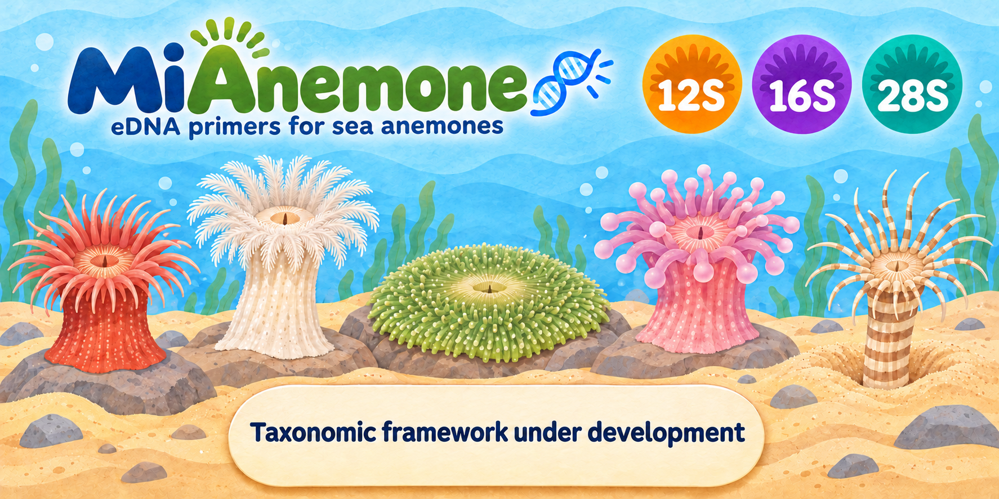

# MiAnemone: in silico design and evaluation of mitochondrial and nuclear rRNA primers for sea anemone (Actiniaria) eDNA metabarcoding

**Fei Xia**

<!-- publication:start -->
**预印本 v1.5 · 2026 年 11 月 5 日 · 未经同行评审。**

[PDF](publications/MiAnemone_preprint.pdf) · [论文 Markdown](publications/MiAnemone_preprint.md) · [固定版本](https://github.com/GUIBA-EX/MiAnemone/releases/tag/preprint-v1.5) · [CITATION.cff](CITATION.cff) · [BibTeX](CITATION.bib) · [构建与更新](publications/README.md)
<!-- publication:end -->

[English](README.en.md) · [修订论文 PDF](publications/MiAnemone_preprint.pdf) · [逐条回复](publications/response_to_review.md) · [复现说明](revision/README.md)

## 使用入口

| 用途 | 优先候选 |
| --- | --- |
| 短片段检测 | 12S XSD |
| 匹配与参考序列区分度 | 12S MD |
| 更广的目标覆盖 | 16S LD |
| 补充线粒体共享条形码的区分度 | 28S LD；需进一步评估背景扩增 |

[引物序列](primers.fasta) · [引物与匹配图](#引物与碱基匹配图) · [论文PDF](publications/MiAnemone_preprint.pdf)

## 摘要

本研究对海葵目线粒体12S和16S rRNA的22对普通与简并引物进行计算评估。原设计面板分别包含250和265个具名物种。本轮补充公共物种面板、非嵌套普通/D的因子分解、错配位置、统一目标/背景模型、全部具名记录敏感性、固定窗口属级留出及条形码区分度。12S XS的G10A使完全匹配从2增至192/245，覆盖仍为205种，但该替换使用了事后放宽的温差门槛。原候选中三组D还改变了固定碱基。现已用嵌套候选替换12S XSD，覆盖227/245、完全匹配212/245，严格背景仍为9条。现有结果支持不同用途下的计算候选优先级，本研究建立了后续试剂评价的计算优先级。

核28S补充8对引物，项目共30对。28S LD覆盖166/172、完全匹配158/172；在67对有可评价28S L序列的线粒体共享条形码物种对中，64对内部序列不同，LD同时覆盖其中63对。严格背景为0，但宽松背景命中340/339个物种，因此其特异性高度依赖末端约束。

## 引言

海葵目的分类研究曾报告约1,200个描述种，并使用12S和16S等标记重建亲缘关系（Rodríguez等，2014）。本研究借鉴MiFish的保守侧翼思路和Anth-28S的简并策略，分别考察结合位点兼容性与内部条形码的信息量。珊瑚虫线粒体演化较慢（Shearer等，2002；Hellberg，2006），较高覆盖并不自动带来较高物种区分度。引物错配可影响扩增偏差（Piñol等，2015），但其作用还取决于位置与反应条件，因此完全匹配增加不能直接换算为检出率增加。

## 材料与方法

### 参考库与比对

原始检索分别获得1,360条12S和2,527条16S记录，可用记录池为786和1,245条。采用GenBank物种名称与谱系，排除sp./cf.等非明确双名记录后，每种选择一个参考，形成250种12S和265种16S设计面板。12S实际排名按明确碱基数、rRNA注释、RefSeq和登录号；12S排序未使用基因组完整性。16S另使用基因组完整性与参考列覆盖排名。尚未完成WoRMS同物异名全面整理或标本误鉴定核验。

MAFFT 7.526参数为`--adjustdirection --retree 2 --maxiterate 0 --thread 4`，不是结构感知比对。坐标为*Metridium senile* NC_000933.1相应基因的一起算闭区间；12S位于线粒体12,201–13,282，16S位于72–2,260。普通/D共享四个端点，但不保证D必然包含普通序列。

### 候选生成、热力学与替换规则

初始搜索每3个参考碱基取一个起点，尝试20/22 nt，要求至少10种或10%目标物种提供完整位点。普通候选来自观察模体与共识；简并位点限于3′半段，每端至多8个变体。按覆盖、完全匹配、较低简并度排序，并在坐标分箱内保留有限候选，再于所选窗口重新配对。该过程有候选截断，是启发式搜索而非全局最优证明。

末端过滤排除可形成五连同碱基、末三位同碱基及不符合GC条件的候选。末位可简并，但兼容须由实际变体提供。primer3-py 2.4.0使用50 mM单价盐、1.5 mM二价盐、0.6 mM dNTP，分别评估50 nM/变体和200 nM/方向均分两种情景。初始最低Tm为45°C、结构Tm低于55°C、F/R温差≤5°C，没有额外全序列GC百分比门槛。

G10A所用6°C例外是检查该候选后提出的事后规则。补充表列出了23个后续候选在ΔTm 4–7°C及新碱基频率80–95%网格下的全部判定。线粒体22对序列未因本轮解释性控制而自动替换。

### 配对模型与评价指标

可评价要求参考跨越两端且结合区没有模糊碱基，允许比对缺口；完整等长模体是更严格子集。原始双链扫描要求产物100–500 bp、内部≥50 bp；覆盖为每端≤2错配且末三位零错配，完全匹配为两端零错配。D允许任意一个F变体与任意一个R变体共同匹配。

原背景为322个12S刺胞动物物种和1,775条16S刺胞动物记录，原扫描允许内部0–1,000 bp。严格WC/GT使用两错配及末三位规则；宽松WC为三错配无末端限制，宽松GT为两错配无末端限制。GT将指定的潜在摇摆配对计为兼容，包括末端。本轮额外统一目标和背景几何范围，比较WC/GT、每端0–4错配、末0/3/5位保护。位置连续罚分是自定义诊断，不是校准的PCR效率。

公共覆盖面板取各窗口均可评价的物种；公共区分度进一步要求各窗口内部序列全部明确。计算物种唯一性、覆盖∩唯一性、最近邻编辑距离、属/科归属、多记录观察barcode gap和留一记录最近邻分类。Wilson区间以当前面板为条件，不代表海葵目随机抽样。

全部具名记录池为694条12S和1,116条16S，报告任一/多数/全部记录匹配及种内位点变异。五折按属分块，在训练属内重建普通/D并经过热力学过滤，再扫描留出属。端点与比对仍来自全数据，背景未用于调节这些诊断候选，因此属于固定窗口条件测试，不是完全独立的窗口发现验证。

### 核28S参考与筛选

28S检索获得11,964条记录；依据注释提取核rRNA，排除非明确双名、长度不足150 nt或模糊碱基超过2%的记录，每种保留明确碱基数最多的代表。最终包含221个海葵物种及448个其他六放珊瑚物种。MAFFT进行方向校正比对，背景以固定目标比对长度加入；参考为 *Halcampoides purpureus* MT676790.1。借鉴Anth-28S逐位点95%共识并结合实际模体进行有限候选搜索，每条D简并度≤8，不限于3′半段。普通/D四端点一致，所有变体通过末端与热力学筛查。

28S目标和背景统一使用100–500 bp产物、内部≥50 bp；严格模型要求每端≤2错配且末三位兼容，宽松WC3/GT2取消末端限制。C++与独立Python扫描的90,984项检查无差异。跨标记区分度按物种名称关联，去除引物后比较内部序列；线粒体属级留出结果不外推至28S。详见[28S方法与证据](28S/README.md)。

## 结果

### 公共面板与非嵌套对照

公共覆盖面板为12S的240种和16S的67种。16S SD、LD、MD和XLD分别覆盖62、59、58和58/67种；HD为65/67，但其宽松背景较高，不应仅按覆盖推荐。各窗口原始分母不同，不能直接将其百分比当成同一组物种排名。

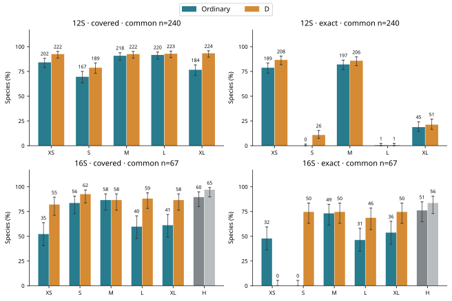

**图1.** 各标记共同可评价物种面板中的覆盖与完全匹配。柱上为物种数，误差线为条件Wilson 95%区间；H/HD作为手动设计位点对照置于最后。

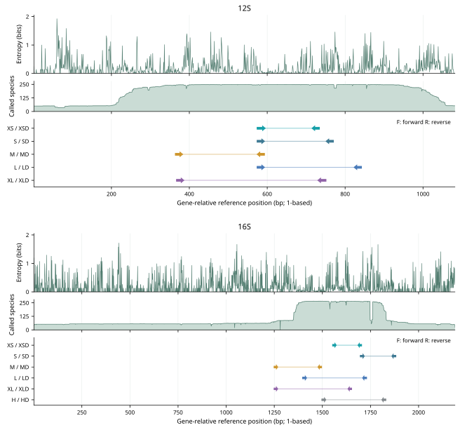

**图2.** 每个标记依次展示位点Shannon熵、贡献明确A/C/G/T的物种数、分行排列的F/R结合区间，三层共享NC_000933.1对应基因的一起算坐标。缺口和模糊碱基不计入分母；少于两个有效物种的位置不绘制熵值。低样本量下的低熵不表示已证实保守。箭头覆盖实际结合区间并指向3′端，连接线表示中间区域。普通与D端点相同，共用一行；12S与16S使用各自的坐标尺度。

替换前的三组非嵌套对是12S XS/XSD、12S S/SD和16S XS/XSD。仅将简并位点加入普通12S XS，覆盖为227/245、完全匹配为212/245；仅改变固定碱基则为205覆盖、0完全匹配。两类变化同时存在才得到原XSD的230覆盖、0完全匹配。因此零完全匹配主要是固定碱基效应。16S XS嵌套控制为223覆盖、167完全匹配，但末端过滤不通过。12S XS嵌套对照两项过滤均通过，最大温差4.84°C，现正式替换为XSD并列为短片段优先候选，普通XS保持不变。

### 共识替换与位置效应

12S XS的230个完整模体中，G10位点有228个A、2个G；另15个可评价物种存在缺口或结合段长度变化。G10A后的F/R温差为50 nM时5.18°C、200 nM时5.33°C。12S S的F9C→A保持173种覆盖，完全匹配0→4，最大温差5.95°C，未满足事后规则的10个百分点增益。L的F1T→C使完全匹配1→202，但两种Lebrunia不再符合两错配规则；原XSD另涉及Phyllodiscus，均属归档分类中的Aliciidae。这是阈值预测，不是必然不能PCR扩增。

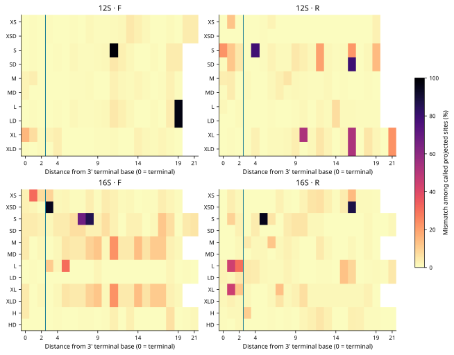

**图3.** 明确同源碱基中的错配比例，横轴从3′末端的0位开始；竖线分隔末端三位。分母排除缺口及模糊碱基，白格表示超出引物长度或没有明确观测。

### 统一背景模型、种内记录与留出

统一长度后，16S H/HD的宽松WC背景从486/976变为452/939，仍然较高；LD由46降至45。原12S XS、XSD、M、MD、L和LD的严格WC命中是完全相同的9条黑珊瑚记录。两套扫描实现在统一严格WC/GT模型下完成57,584次记录—模型比较，零差异。原500/501计数没有截断。

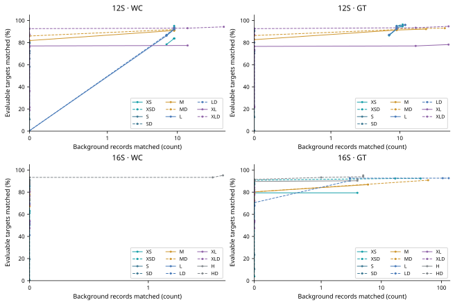

**图4.** 相同产物几何约束下的目标覆盖与背景命中数，末三位保持匹配，每条曲线连接每端允许0至4个错配的结果。横轴采用非负symlog尺度，0–1为线性区；实线为普通、虚线为D。

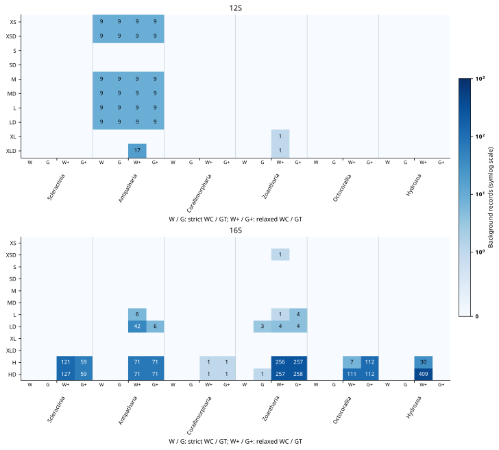

**图5.** 22对引物在原始背景面板中的命中数，按分类群分组。W/G为严格WC/GT，W+/G+为宽松模型；仅标注非零值，两幅面板共享同一计数色阶。各标记背景库大小不同，原始计数不能直接解释为标记间特异性差异。

全部记录分析中，12S XS在247个可评价物种里，任一/多数/全部记录覆盖为208/206/203；16S LD为233/232/225，分母259。重新比对也影响可评价分母。属级重选中，12S M普通/D分别覆盖219/226与219/226、完全匹配197与205；16S L普通/D分别覆盖137/246与213/246、完全匹配106与186。候选在每折重新生成，不能解释为对固定正式引物的外部验证。

### 区分度、结合位置与使用限制

原12S唯一内部序列为XS 35/244、S 44/244、M 86/239、L 68/243、XL 100/239。L低于M，说明区分度不随长度单调增加。共同完整面板进一步将扩增兼容性与唯一性相交：

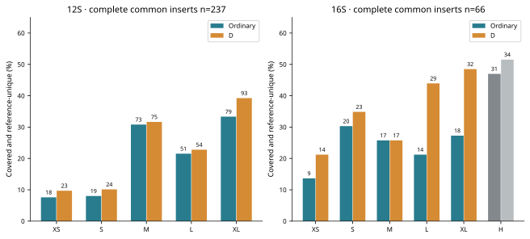

**图6.** 共同完整插入序列面板中，同时满足覆盖与参考序列唯一性的物种比例，柱上为物种数。该指标描述已采样参考库，不等同于实验验证的物种鉴定成功率。

多记录分析中，12S XS只有11/111个多记录物种具有正的观察barcode gap，XL为28/110；严格留一记录最近邻正确归属为52/658和179/646。这些结果仍受种内采样不足影响。

12S XS-F与M/MD-R、SD-F与M/MD-R等共享区域的互补作用使跨配对异二聚体Tm超过55°C，不宜直接混为多重体系。实际产物的最小/中位/最大长度和名义双端20 bp重叠统计见论文Table2及`revision/length_summary.csv`。实际接头待定，尚未评估带接头结构。

### 核28S补充分辨率

核28S新增221个海葵物种与448个其他六放珊瑚背景物种。XS、S、M、L各保留普通及D引物，同窗端点一致，每条简并度≤8。逐位点95%共识用于有限候选搜索，不代表整对95%覆盖。严格背景均为0，但宽松命中仍较高。所有可比较12S、16S窗口均共享条形码的112个物种对中，67对有可评价28S L序列；64对可区分，LD覆盖其中63对的两个物种。跨标记按物种名称关联，不代表相同个体。

## 使用优先级与讨论

| 用途 | 计算优先候选 | 主要取舍 |
| --- | --- | --- |
| 短片段检测 | 12S XSD | 末端及热力学过滤通过，覆盖227/245、完全匹配212/245；未评价鱼类、甲壳类共扩增 |
| 覆盖与区分度兼顾 | 12S MD | 完全匹配较高；存在黑珊瑚背景 |
| 较广16S目标兼容性 | 16S LD | 较L显著增加覆盖；宽松背景也增加 |
| 黑珊瑚共存环境 | 对本地参考比较12S S/SD及16S候选 | 背景与目标完整性必须一起判断 |
| 手工位点历史比较 | H/HD | 宽松背景过高，不优先推荐 |
| 多重PCR | 不作现成混合推荐 | 共享位点二聚体及接头需独立评估 |

同坐标隔离的是位置差异，只有嵌套序列才能进一步解释简并效应。覆盖、完全匹配和物种分辨率需要分别报告。当前模型不是环境样本检出率；没有新增湿实验。背景结果限定于原刺胞动物参考库。独立窗口发现、冻结后时间外推及分类名称全面核验尚未完成。

## 引物与碱基匹配图

按12S、16S、28S依次列出全部30对。序列均为5′→3′；D表示简并版本。结合位置图使用各基因独立参考坐标，箭头表示方向，跨度包含两端引物。覆盖/完全匹配为各自可评价物种计数，分母不同的窗口不能直接排名。

[FASTA](primers.fasta) · [CSV](all_results.csv)

### 12S

| 名称 | F（5′–3′） | R（5′–3′） | F/R简并度 | 覆盖 | 完全匹配 | 碱基匹配图 |
|---|---|---|---|---|---|---|
| XS | CGAAAGGTAAAATCTTCCGCCT | CGACGGCCATGCAATACCGG | 1/1 | 205/245 | 192/245 | [F / R](figures/template_matching/12S_XS.svg) |
| XSD | CGAAAGGTAAAATCTTCCGCCT | CGACGGCCATGCARTACCDG | 1/6 | 227/245 | 212/245 | [F / R](figures/template_matching/12S_XSD.svg) |
| S | CGAAAGGTCAAATCTTCCGC | CGGGTTGGGTCCCTTTTAGC | 1/1 | 173/246 | 0/246 | [F / R](figures/template_matching/12S_S.svg) |
| SD | CGAAAGGTAAAATCTTCCGC | CGGATTGGGTCCCTTYTAGY | 1/4 | 195/246 | 26/246 | [F / R](figures/template_matching/12S_SD.svg) |
| M | AAGGCGTAAAGGATGTGTAG | GCGGAAGATTTTACCTTTCG | 1/1 | 220/242 | 198/242 | [F / R](figures/template_matching/12S_M.svg) |
| MD | AAGGCGTAAAGGATGTGTVG | GCGGAAGATTTDACCTTTCR | 3/6 | 224/242 | 208/242 | [F / R](figures/template_matching/12S_MD.svg) |
| L | TGAAAGGTAAAATCTTCCGC | TATAAGAAAATGTAGCGCAT | 1/1 | 226/246 | 1/246 | [F / R](figures/template_matching/12S_L.svg) |
| LD | TGAAAGGTAAAATCTTCCGC | TATAAGAAAATGTAGCGCAY | 1/2 | 229/246 | 1/246 | [F / R](figures/template_matching/12S_LD.svg) |
| XL | GCGTAAAGGATGTGTAGGCC | CTTAACACACGGACTTACGACG | 1/1 | 185/243 | 46/243 | [F / R](figures/template_matching/12S_XL.svg) |
| XLD | GCGTAAAGGATGTGTARGYY | CTTAACACACGRACTTACGACG | 8/2 | 225/243 | 52/243 | [F / R](figures/template_matching/12S_XLD.svg) |

12S MD — 碱基匹配预览

[Full species](figures/template_matching/12S_MD.svg)

### 16S

| 名称 | F（5′–3′） | R（5′–3′） | F/R简并度 | 覆盖 | 完全匹配 | 碱基匹配图 |
|---|---|---|---|---|---|---|
| H | AAGACCCCATTGAGCTTTACTA | CCCCATGGTAGCTTTTATTCGT | 1/1 | 146/165 | 122/165 | [F / R](figures/template_matching/16S_H.svg) |
| HD | AAGACCCCATTGAGCTTTACYW | CCCCATGGTAGCTTTTATYCRT | 4/4 | 154/165 | 136/165 | [F / R](figures/template_matching/16S_HD.svg) |
| XS | AGTTTAGATAATGTGGGATC | TAACTACGGACCTTAAGCTC | 1/1 | 165/262 | 132/262 | [F / R](figures/template_matching/16S_XS.svg) |
| XSD | AGTTTAGATAATGTGGARBC | TAATTACGGACCTTAAGCTC | 6/1 | 223/262 | 1/262 | [F / R](figures/template_matching/16S_XSD.svg) |
| S | CGTAGTTAATAGCAAGTGGCCT | AGGTCGCAAACATCGTTGTCGA | 1/1 | 63/77 | 0/77 | [F / R](figures/template_matching/16S_S.svg) |
| SD | CGTAGTTAATAGCHRGTGGCCT | AGGTCGCAAACATCGKYGTCRA | 6/8 | 70/77 | 56/77 | [F / R](figures/template_matching/16S_SD.svg) |
| M | AAGCTAAATGCTGAAGTATG | TTCGTCTTACAATATGGACG | 1/1 | 61/76 | 51/76 | [F / R](figures/template_matching/16S_M.svg) |
| MD | AAGCTAAATGCTGAAGTATG | TTCGTCTTACAATWTGDACG | 1/6 | 61/76 | 52/76 | [F / R](figures/template_matching/16S_MD.svg) |
| L | GGCCGGTATGAATGGCGTCACG | CCCCTTGCAGTCAGGCCACCGG | 1/1 | 138/258 | 106/258 | [F / R](figures/template_matching/16S_L.svg) |
| LD | GGCCGGTATGAATGGCRYYACG | CCCCTTGCAGTCAGGCCACYDG | 8/6 | 231/258 | 180/258 | [F / R](figures/template_matching/16S_LD.svg) |
| XL | AAGCTAAATGCTGAAGTATG | AACCAAACTATCCAACTTAC | 1/1 | 41/76 | 36/76 | [F / R](figures/template_matching/16S_XL.svg) |
| XLD | AAGCTAAATGCTGAAGTATG | AACCAAACTATCYAACTYRC | 1/8 | 61/76 | 52/76 | [F / R](figures/template_matching/16S_XLD.svg) |

16S LD — 碱基匹配预览

[Full species](figures/template_matching/16S_LD.svg)

### 28S

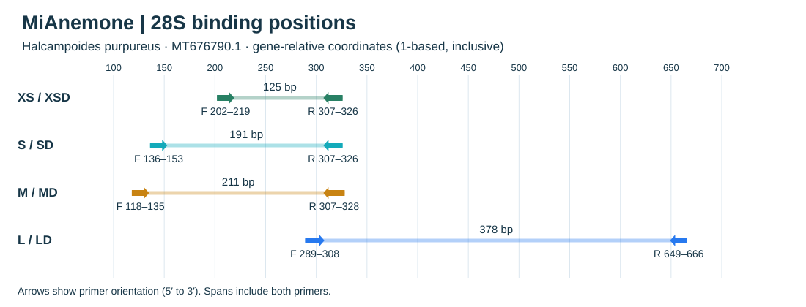

| 名称 | F（5′–3′） | R（5′–3′） | F/R简并度 | 覆盖 | 完全匹配 | 碱基匹配图 |
|---|---|---|---|---|---|---|
| XS | GGGTTGTTTGGGAATGCA | TTGACTCTCTTTTCAAAGTG | 1/1 | 179/182 | 7/182 | [F / R](figures/template_matching/28S_XS.svg) |
| XSD | GGGTTGTTYKGGAATGCA | TKRACTCTCTTTTCAAAGTG | 4/4 | 179/182 | 177/182 | [F / R](figures/template_matching/28S_XSD.svg) |
| S | CGTCATAGAGGGTGACAA | TTAACTCTCTTTTCAAAGTG | 1/1 | 163/182 | 134/182 | [F / R](figures/template_matching/28S_S.svg) |
| SD | CGTCRTAGAGGGTGASAA | TTRACTCTCTTTTCAAAGTG | 4/2 | 172/182 | 148/182 | [F / R](figures/template_matching/28S_SD.svg) |
| M | AAGTTGCTTGGAACAGCA | TTTTAACTCTCTTTTCAAAGTG | 1/1 | 169/180 | 139/180 | [F / R](figures/template_matching/28S_M.svg) |
| MD | AAGTTGCTTGGAACAGCA | KTTTAACTCTCTTTTCAAAGTG | 1/2 | 169/180 | 154/180 | [F / R](figures/template_matching/28S_MD.svg) |
| L | TGAGGGAAAGGTGAAAAGCA | ACTGCAAGCAGTCCACCG | 1/1 | 94/172 | 0/172 | [F / R](figures/template_matching/28S_L.svg) |
| LD | TGAGGGAAAGRTGAAAAGCA | ACTGCAHGCAGTCCACCR | 2/6 | 166/172 | 158/172 | [F / R](figures/template_matching/28S_LD.svg) |

28S XS — 碱基匹配预览

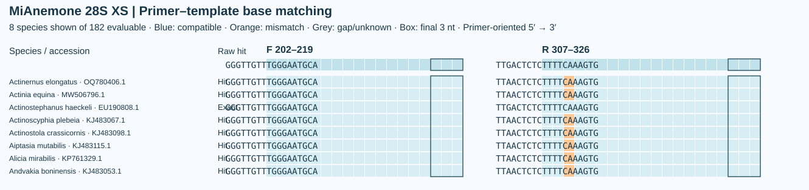

[Full species](figures/template_matching/28S_XS.svg)

28S XSD — 碱基匹配预览

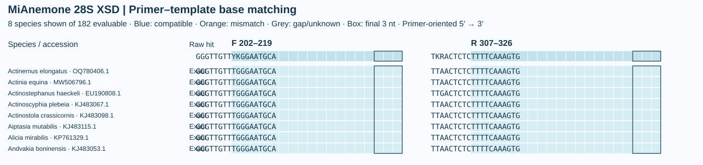

[Full species](figures/template_matching/28S_XSD.svg)

28S S — 碱基匹配预览

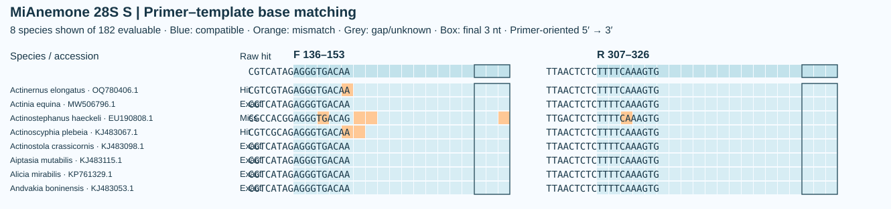

[Full species](figures/template_matching/28S_S.svg)

28S SD — 碱基匹配预览

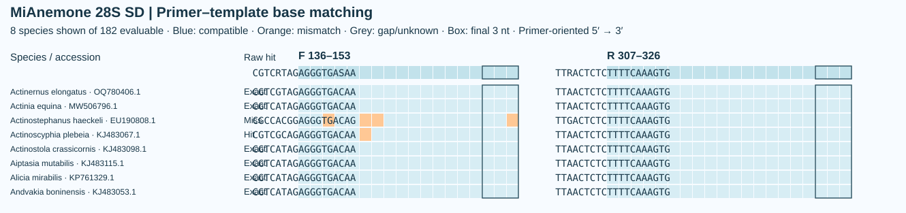

[Full species](figures/template_matching/28S_SD.svg)

28S M — 碱基匹配预览

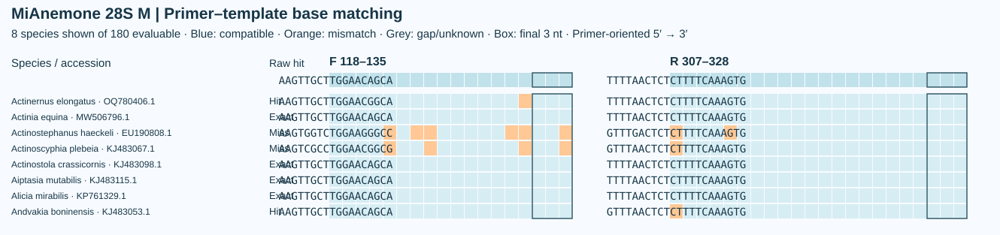

[Full species](figures/template_matching/28S_M.svg)

28S MD — 碱基匹配预览

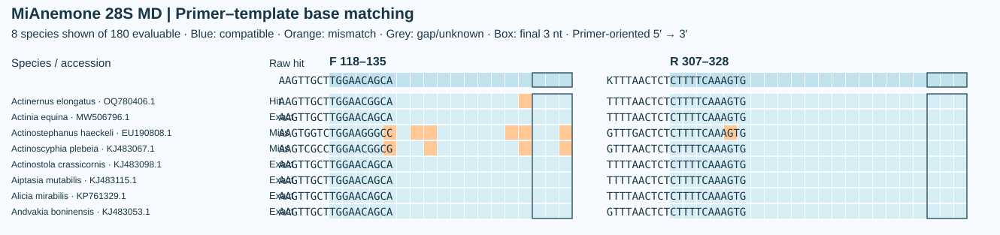

[Full species](figures/template_matching/28S_MD.svg)

28S L — 碱基匹配预览

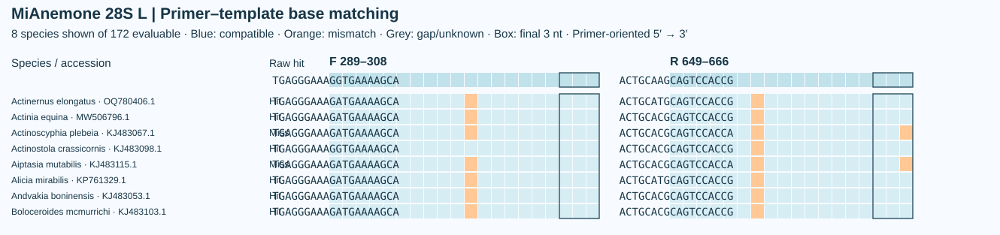

[Full species](figures/template_matching/28S_L.svg)

28S LD — 碱基匹配预览

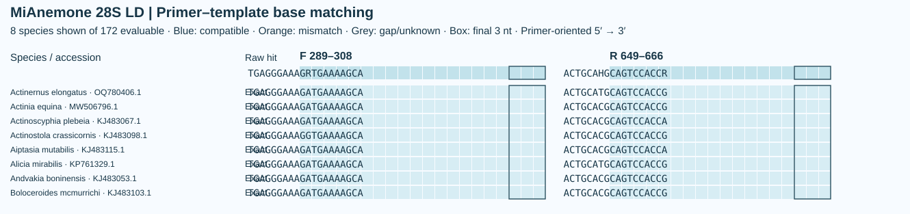

[Full species](figures/template_matching/28S_LD.svg)

## 数据与复现

[12S/16S analysis](revision/README.md) · [28S analysis](28S/README.md) · [Preprint and build](publications/README.md) · [Supplement](publications/MiAnemone_supplement.md)

## 引用 / Citation

Xia, F. (2026). *MiAnemone: in silico design and evaluation of mitochondrial and nuclear rRNA primers for sea anemone (Actiniaria) eDNA metabarcoding*. Computational preprint v1.5. [GitHub Release](https://github.com/GUIBA-EX/MiAnemone/releases/tag/preprint-v1.5).

[著作权声明](COPYRIGHT.md)

## 参考文献

Bae S. 2025. Validation of improved cytochrome c oxidase I (COI) primers for comprehensive biodiversity assessment of ascidians. *PeerJ* 13:e19671. https://doi.org/10.7717/peerj.19671

Hellberg ME. 2006. No variation and low synonymous substitution rates in coral mtDNA despite high nuclear variation. *BMC Evolutionary Biology* 6:24. https://doi.org/10.1186/1471-2148-6-24

Katoh K, Standley DM. 2013. MAFFT multiple sequence alignment software version 7: improvements in performance and usability. *Molecular Biology and Evolution* 30:772–780. https://doi.org/10.1093/molbev/mst010

McCartin L et al. 2024. Nuclear eDNA metabarcoding primers for anthozoan coral biodiversity assessment. *PeerJ* 12:e18607. https://doi.org/10.7717/peerj.18607

Miya M et al. 2015. MiFish, a set of universal PCR primers for metabarcoding environmental DNA from fishes: detection of more than 230 subtropical marine species. *Royal Society Open Science* 2:150088. https://doi.org/10.1098/rsos.150088

Piñol J, Mir G, Gomez-Polo P, Agustí N. 2015. Universal and blocking primer mismatches limit the use of high-throughput DNA sequencing for the quantitative metabarcoding of arthropods. *Molecular Ecology Resources* 15:819–830. https://doi.org/10.1111/1755-0998.12355

Rodríguez E et al. 2014. Hidden among sea anemones: the first comprehensive phylogenetic reconstruction of the order Actiniaria (Cnidaria, Anthozoa, Hexacorallia) reveals a novel group of hexacorals. *PLOS ONE* 9:e96998. https://doi.org/10.1371/journal.pone.0096998

SantaLucia J Jr. 1998. A unified view of polymer, dumbbell, and oligonucleotide DNA nearest-neighbor thermodynamics. *Proceedings of the National Academy of Sciences USA* 95:1460–1465. https://doi.org/10.1073/pnas.95.4.1460

Shearer TL, Van Oppen MJH, Romano SL, Wörheide G. 2002. Slow mitochondrial DNA sequence evolution in the Anthozoa (Cnidaria). *Molecular Ecology* 11:2475–2487. https://doi.org/10.1046/j.1365-294X.2002.01652.x

Untergasser A et al. 2012. Primer3—new capabilities and interfaces. *Nucleic Acids Research* 40:e115. https://doi.org/10.1093/nar/gks596

Wilson EB. 1927. Probable inference, the law of succession, and statistical inference. *Journal of the American Statistical Association* 22:209–212. https://doi.org/10.2307/2276774
