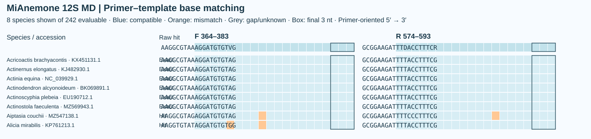
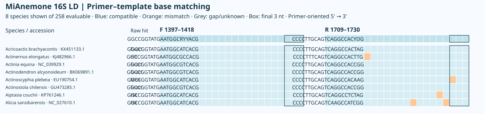

# MiAnemone, a set of universal PCR primers for metabarcoding environmental DNA from sea anemones

*MiAnemone，一组用于海葵环境 DNA 宏条形码分析的通用 PCR 引物*

**Fei Xia**

[English](README.en.md) | 中文

[计算预印本（PDF）](publications/MiAnemone_preprint.pdf)

## 摘要

本研究针对海葵目（Actiniaria）的线粒体 12S 和 16S rRNA 基因设计并计算评估了 22 对引物。在 250 种海葵的 12S 参考库中，MD 覆盖 224/242 个可评价物种，208 个物种的双端均完全匹配。在 265 种海葵的 16S 参考库中，LD 覆盖 231/258 个可评价物种，其中 180 个双端完全匹配。严格 Watson–Crick 模型下，两者在各自背景库中分别命中 9 条和 0 条记录。

## 引言

环境 DNA 宏条形码设计需要同时考虑扩增子长度、目标物种间的结合位点变异以及近缘非目标类群的匹配。MiFish 的保守侧翼设计和 Anth-28S 的简并位点设计为本研究提供了两条途径（Miya 等，2015；McCartin 等，2024）。本研究在两个线粒体基因上分别设置 XS 至 XL 五档窗口，通过比较同一位置的普通与简并引物，考察覆盖增加时完全匹配和背景命中如何变化。

## 材料与方法

每个基因按 GenBank 具名物种各保留一条目标参考序列。结合位置采用 *Metridium senile* NC_000933.1 对应基因的无缺口坐标，从 1 起算，包含两端。同一窗口的普通与 D 共享 F、R 的四个端点。普通方案依照 MiFish 的保守侧翼思路，从实际模板和共识序列选配；D 方案依照 Anth-28S 的思路补偿谱系变异，每条引物简并度至多为 8，简并位点限于 3′ 半段。

可评价物种须有跨越两端的参考序列，且结合区中无模糊碱基。对原始序列双链搜索 100–500 bp 的成对产物，内部序列至少 50 bp。覆盖要求每端至多两个错配且各自 3′ 末三位兼容；完全匹配要求两端均为零错配。覆盖率和完全匹配率均以该窗口的可评价物种数为分母。两个基因使用各自的目标和背景面板。

背景搜索允许两引物之间相距 0–1000 bp。严格模型沿用每端至多两个错配和末三位兼容的规则，分别计算 Watson–Crick 配对（WC）及允许 G–T 配对（GT）的命中。宽松模型取消末端限制，分别允许 WC 每端三个错配和 GT 每端两个错配。候选通过条件为两个严格计数各 ≤10、两个宽松计数各 ≤50。下表每格按**普通 / D**排列，背景每组依次列出 **WC,GT** 的记录数。所有命中均为计算预测。

## 结果

### 12S

目标面板含 250 种海葵，背景含 322 种其他刺胞动物，各物种一条记录。

| 窗口 | 跨度（bp） | 可评价物种 | 覆盖物种 | 完全匹配物种 | 严格背景 | 宽松背景 | 碱基匹配图 |
|---|---:|---:|---:|---:|---:|---:| --- |
| XS | 161 | 245 | 205 / 230 | 2 / 0 | 9,9 / 9,9 | 9,9 / 9,9 | [XS](figures/template_matching/12S_XS.svg) / [XSD](figures/template_matching/12S_XSD.svg) |
| S | 197 | 246 | 173 / 195 | 0 / 26 | 0,0 / 0,0 | 0,0 / 0,0 | [S](figures/template_matching/12S_S.svg) / [SD](figures/template_matching/12S_SD.svg) |
| M | 230 | 242 | 220 / 224 | 198 / 208 | 9,9 / 9,9 | 9,9 / 9,9 | [M](figures/template_matching/12S_M.svg) / [MD](figures/template_matching/12S_MD.svg) |
| L | 269 | 246 | 226 / 229 | 1 / 1 | 9,9 / 9,9 | 9,9 / 9,9 | [L](figures/template_matching/12S_L.svg) / [LD](figures/template_matching/12S_LD.svg) |
| XL | 385 | 243 | 185 / 225 | 46 / 52 | 0,0 / 0,0 | 1,0 / 18,0 | [XL](figures/template_matching/12S_XL.svg) / [XLD](figures/template_matching/12S_XLD.svg) |

[逐物种结果](12S/species_results.csv) · [非目标命中明细](12S/background_hits.csv) · [参考坐标](12S/coordinates.csv) · [内部条码唯一性](12S/barcode_identity.csv)

图中逐行显示物种及其 GenBank 登录号。蓝色为 IUPAC 兼容，橙色为错配，灰色为缺口或未知碱基。F、R 均按引物 5′→3′ 方向显示，方框圈出末三位。图中投影到参考碱基，省略相对参考的插入列。「Raw hit」来自完整序列的成对搜索。下图从八个科各取一个物种作为示例，表中链接包含各引物的全部可评价物种。

### 16S

目标面板含 265 种海葵，背景含 1,775 条其他刺胞动物记录。S、M 和 XL 两端均可评价的物种只有 76–77 个，解释覆盖率时应同时考虑分母。

| 窗口 | 跨度（bp） | 可评价物种 | 覆盖物种 | 完全匹配物种 | 严格背景 | 宽松背景 | 碱基匹配图 |
|---|---:|---:|---:|---:|---:|---:| --- |
| XS | 152 | 262 | 165 / 223 | 132 / 1 | 0,0 / 0,0 | 0,0 / 1,0 | [XS](figures/template_matching/16S_XS.svg) / [XSD](figures/template_matching/16S_XSD.svg) |
| S | 186 | 77 | 63 / 70 | 0 / 56 | 0,0 / 0,0 | 0,0 / 0,0 | [S](figures/template_matching/16S_S.svg) / [SD](figures/template_matching/16S_SD.svg) |
| M | 248 | 76 | 61 / 61 | 51 / 52 | 0,0 / 0,0 | 0,0 / 0,0 | [M](figures/template_matching/16S_M.svg) / [MD](figures/template_matching/16S_MD.svg) |
| L | 334 | 258 | 138 / 231 | 106 / 180 | 0,0 / 0,3 | 7,4 / 46,10 | [L](figures/template_matching/16S_L.svg) / [LD](figures/template_matching/16S_LD.svg) |
| XL | 404 | 76 | 41 / 61 | 36 / 52 | 0,0 / 0,0 | 0,0 / 0,0 | [XL](figures/template_matching/16S_XL.svg) / [XLD](figures/template_matching/16S_XLD.svg) |
| H / HD | 334 | 165 | 146 / 154 | 122 / 136 | 0,0 / 0,1 | 486,500 / 976,501 | [H](figures/template_matching/16S_H.svg) / [HD](figures/template_matching/16S_HD.svg) |

H 和 HD 共用原位点（F 1497–1518，R 1809–1830）。HD 比 H 多覆盖 8 个物种，多完全匹配 14 个；两者的宽松背景命中均超过筛选门槛。

[逐物种结果](16S/species_results.csv) · [非目标命中明细](16S/background_hits.csv) · [参考坐标](16S/coordinate_check.csv) · [内部条码唯一性](16S/insert_resolution.csv) · [含 H 和 HD 的 16S 序列](16S/primers.fasta)

图中逐行显示物种及其 GenBank 登录号。蓝色为 IUPAC 兼容，橙色为错配，灰色为缺口或未知碱基。F、R 均按引物 5′→3′ 方向显示，方框圈出末三位。图中投影到参考碱基，省略相对参考的插入列。「Raw hit」来自完整序列的成对搜索。下图从八个科各取一个物种作为示例，表中链接包含各引物的全部可评价物种。

## 讨论

12S MD 在双端完全匹配方面表现最好。与同位点普通 M 相比，它多覆盖 4 个物种，多完全匹配 10 个，严格背景命中数相同。若目标是更短的扩增子和更少的非目标命中，197 bp 的 SD 覆盖 195/246 个物种，在四个背景模型下均为零命中。16S LD 相比普通 L 多覆盖 93 个物种，但宽松 WC 背景命中从 7 条增加到 46 条。

短窗口并不总能兼顾两项指标。12S XSD 覆盖 230/245 个物种，却没有双端完全匹配；16S XSD 相比 XS 多覆盖 58 个物种，完全匹配数却从 132 降至 1。普通与 D 在同一位置独立选序，选择时应同时看两项指标。跨窗口比较还应考虑参考序列是否跨越两端，尤其是 16S 中可评价物种较少的窗口。这些结果描述计算预测的模板兼容性，实际样本中的扩增效率仍待测定。

## 数据与复现

引物序列按合成方向 5′→3′ 给出，名称含基因、引物对及方向，例如 `12S_MD_F`。逐对结果表含序列、参考坐标和背景计数。[引物 FASTA](primers.fasta) · [完整结果](all_results.csv)

两个基因目录均包含目标与背景参考序列、物种名录及目标比对。安装 Biopython 后，在仓库根目录运行 `python3 scripts/verify.py` 可复核命中；运行 `python3 scripts/binding_positions.py` 可重绘位置图。独立复核中，12S 的 8,940 项与 16S 的 45,780 项检查均无差异。[12S 复核](12S/validation.json) · [16S 复核](16S/validation.json)

[引用信息](CITATION.cff) · [著作权与使用声明](COPYRIGHT.md)

## 参考文献

1. Miya M et al. (2015). MiFish, a set of universal PCR primers for metabarcoding environmental DNA from fishes: detection of more than 230 subtropical marine species. *Royal Society Open Science*, 2, 150088. [DOI](https://doi.org/10.1098/rsos.150088)
2. McCartin L et al. (2024). Nuclear eDNA metabarcoding primers for anthozoan coral biodiversity assessment. *PeerJ*, 12, e18607. [DOI](https://doi.org/10.7717/peerj.18607)
