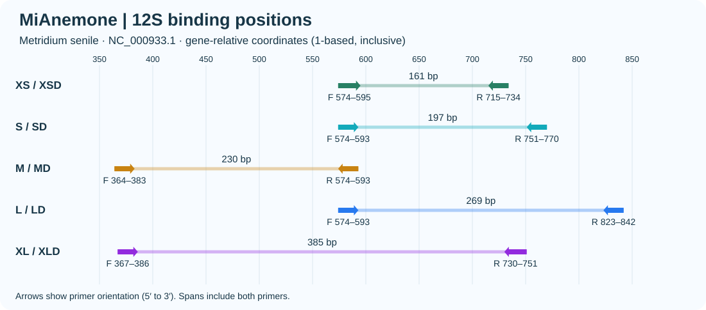
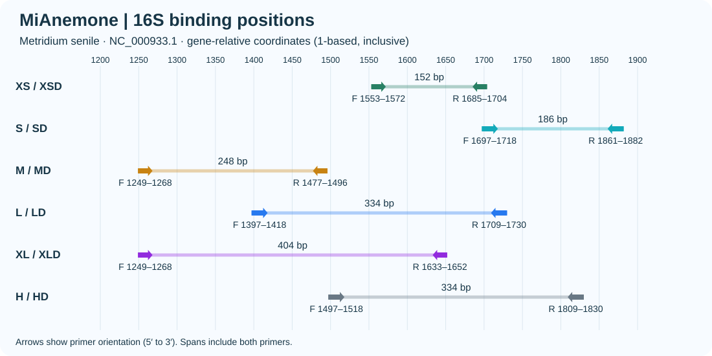

# MiAnemone · 海葵目线粒体 12S 与 16S eDNA 引物

[English](README.en.md) | 中文

本项目比较海葵目（Actiniaria）两个线粒体标记的五档引物窗口，并收录 16S 原位点的 H 和 HD，共 22 对。每档保留一对普通引物及一对同坐标简并引物（D）。合并 FASTA 的序列名带基因前缀，例如 `12S_MD_F`，所有序列均按合成方向 5′→3′ 给出。

[候选引物 FASTA](primers.fasta) · [全部结果与坐标 CSV](all_results.csv)

## 候选选择

- **12S MD** 的双端完全匹配最多。242 个可评价物种中覆盖 224 个（92.6%），完全匹配 208 个（86.0%）。普通 M 分别为 220 和 198 个。二者在严格 WC 模型下均命中 9 个背景物种。需要更短且对当前背景命中少的窗口时，12S SD 的跨度为 197 bp，覆盖 195/246，严格与宽松背景均为零。
- **16S LD** 在 258 个可评价物种中覆盖 231 个（89.5%），完全匹配 180 个（69.8%）。同坐标普通 L 分别为 138 和 106 个。LD 的严格 WC、GT 背景命中分别为 0 和 3 条，宽松条件下增至 46 和 10 条。
- **短窗口的权衡**尤其明显。12S XSD 覆盖 230/245，但双端完全匹配为 0。16S XSD 相比普通 XS 多覆盖 58 个物种，但完全匹配由 132 个降至 1 个。两种方案独立选序，D 只表示存在简并位点。

## 计算方法

每个基因按 GenBank 具名物种各保留一条目标参考序列。结合位置采用 *Metridium senile* NC_000933.1 对应基因的无缺口坐标，从 1 起算，包含两端。同一窗口的普通与 D 共享 F、R 的四个端点。普通方案依照 MiFish 的保守侧翼思路，从实际模板和共识序列选配；D 方案依照 Anth-28S 的思路补偿谱系变异，每条引物简并度至多为 8，简并位点限于 3′ 半段。

可评价物种须有跨越两端的参考序列，且结合区中无模糊碱基。对原始序列双链搜索 100–500 bp 的成对产物，内部序列至少 50 bp。覆盖要求每端至多两个错配且各自 3′ 末三位兼容；完全匹配要求两端均为零错配。覆盖率和完全匹配率均以该窗口的可评价物种数为分母。两个基因使用各自的目标和背景面板。

背景搜索允许两引物之间相距 0–1000 bp。严格模型沿用每端至多两个错配和末三位兼容的规则，分别计算 Watson–Crick 配对（WC）及允许 G–T 配对（GT）的命中。宽松模型取消末端限制，分别允许 WC 每端三个错配和 GT 每端两个错配。候选通过条件为两个严格计数各 ≤10、两个宽松计数各 ≤50。下表每格按**普通 / D**排列，背景每组依次列出 **WC,GT** 的记录数。所有命中均为计算预测。

## 12S

目标面板含 250 种海葵，背景含 322 种其他刺胞动物，各物种一条记录。

| 窗口 | 跨度（bp） | 可评价物种 | 覆盖物种 | 完全匹配物种 | 严格背景 | 宽松背景 |
|---|---:|---:|---:|---:|---:|---:|
| XS | 161 | 245 | 205 / 230 | 2 / 0 | 9,9 / 9,9 | 9,9 / 9,9 |
| S | 197 | 246 | 173 / 195 | 0 / 26 | 0,0 / 0,0 | 0,0 / 0,0 |
| M | 230 | 242 | 220 / 224 | 198 / 208 | 9,9 / 9,9 | 9,9 / 9,9 |
| L | 269 | 246 | 226 / 229 | 1 / 1 | 9,9 / 9,9 | 9,9 / 9,9 |
| XL | 385 | 243 | 185 / 225 | 46 / 52 | 0,0 / 0,0 | 1,0 / 18,0 |

[逐物种结果](12S/species_results.csv) · [非目标命中明细](12S/background_hits.csv) · [参考坐标](12S/coordinates.csv) · [内部条码唯一性](12S/barcode_identity.csv)

## 16S

目标面板含 265 种海葵，背景含 1,775 条其他刺胞动物记录。S、M 和 XL 两端均可评价的物种只有 76–77 个，解释覆盖率时应同时考虑分母。

| 窗口 | 跨度（bp） | 可评价物种 | 覆盖物种 | 完全匹配物种 | 严格背景 | 宽松背景 |
|---|---:|---:|---:|---:|---:|---:|
| XS | 152 | 262 | 165 / 223 | 132 / 1 | 0,0 / 0,0 | 0,0 / 1,0 |
| S | 186 | 77 | 63 / 70 | 0 / 56 | 0,0 / 0,0 | 0,0 / 0,0 |
| M | 248 | 76 | 61 / 61 | 51 / 52 | 0,0 / 0,0 | 0,0 / 0,0 |
| L | 334 | 258 | 138 / 231 | 106 / 180 | 0,0 / 0,3 | 7,4 / 46,10 |
| XL | 404 | 76 | 41 / 61 | 36 / 52 | 0,0 / 0,0 | 0,0 / 0,0 |
| H / HD | 334 | 165 | 146 / 154 | 122 / 136 | 0,0 / 0,1 | 486,500 / 976,501 |

H 和 HD 共用原位点（F 1497–1518，R 1809–1830）。HD 比 H 多覆盖 8 个物种，多完全匹配 14 个；两者的宽松背景命中均超过筛选门槛。

[逐物种结果](16S/species_results.csv) · [非目标命中明细](16S/background_hits.csv) · [参考坐标](16S/coordinate_check.csv) · [内部条码唯一性](16S/insert_resolution.csv) · [含 H 和 HD 的 16S 序列](16S/primers.fasta)

## 复核

独立实现逐条比对原始目标与背景上的成对搜索结果。12S 共 8,940 项、16S 共 45,780 项，均无差异。整合时另以逐物种和逐背景明细重算各引物计数，并核对普通与 D 的结合端点、FASTA 序列和结果表。各基因目录含实际使用的目标与背景 FASTA、分类面板和目标比对文件。

[12S 复核记录](12S/validation.json) · [16S 复核记录](16S/validation.json)

用 `python3 scripts/binding_positions.py` 从结果表重绘两张位置图；用 `python3 scripts/verify.py` 从参考序列复核命中。

作者：Fei Xia。 [著作权与使用声明](COPYRIGHT.md)

## 参考文献

1. Miya et al. (2015). MiFish, a set of universal PCR primers for metabarcoding environmental DNA from fishes. [Royal Society Open Science](https://doi.org/10.1098/rsos.150088)
2. Anth-28S 珊瑚 28S metabarcoding 引物设计研究。 [PeerJ](https://doi.org/10.7717/peerj.18607)
