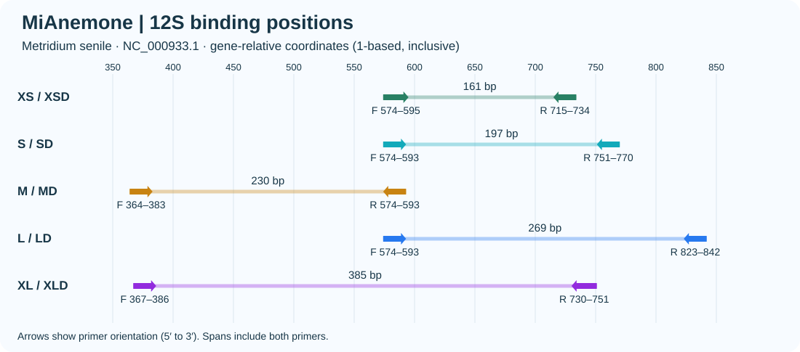
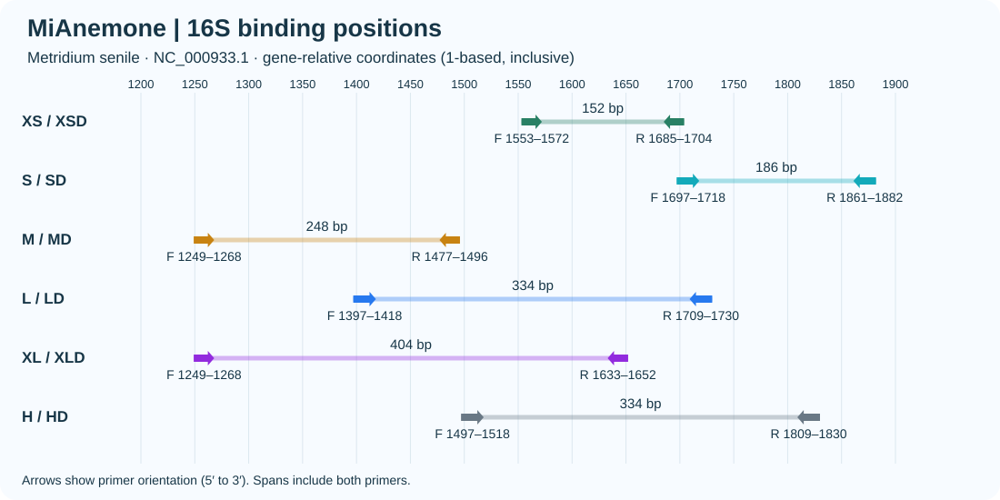
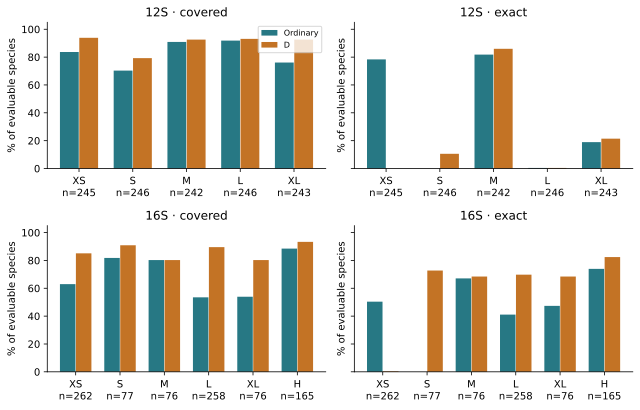
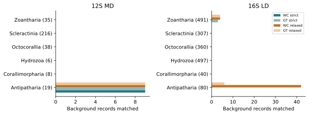
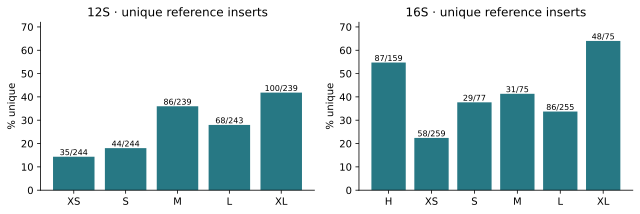

# MiAnemone, a set of universal PCR primers for metabarcoding environmental DNA from sea anemones

**Fei Xia**
Preprint v1.1 · 3 November 2026 · Not peer reviewed

## Abstract

A primer substitution can remove a mismatch in hundreds of templates without changing the number of species predicted to amplify. We investigated this distinction in Actiniaria using 22 primer pairs targeting mitochondrial 12S and 16S rRNA. Each marker included five size windows with ordinary and degenerate primers at identical coordinates. Two additional 16S pairs occupied the original design site. Changing the tenth forward base of 12S XS from G to A increased paired exact matches from 2 to 192 of 245 evaluable species. The same 205 species remained covered and the background hit sets were unchanged. Degeneracy produced a different trade-off at 16S L: LD covered 231 rather than 138 of 258 species, while relaxed Watson–Crick background hits increased from seven to 46 records. A candidate 12S L substitution increased exact matches from one to 202 but lost two species of *Lebrunia*. The shortest 12S insert was unique to one species in only 35 of 244 unambiguous references. These results identify complementary assays for short-fragment detection and reference discrimination and show the value of tracking individual species through primer revision.

**Keywords** · Actiniaria, environmental DNA, primer design, mitochondrial rRNA, metabarcoding

## Introduction

An environmental DNA survey of sea anemones requires conserved primer sites flanking a sequence that distinguishes the taxa of interest. Variation at a binding site and variation within the intervening barcode have different consequences: the former can influence which templates are recovered, whereas the latter determines whether recovered sequences can be distinguished. MiFish exploited conserved flanks around a variable mitochondrial region in fishes (Miya et al., 2015). Anth-28S used degenerate primers to accommodate variation among anthozoans at a nuclear marker (McCartin et al., 2024).

Bae (2025) evaluated redesigned ascidian primers by comparing binding sites, target and background performance, laboratory amplification and barcode distances. Here we use a computational comparison to ask three questions for Actiniaria. Which substitutions improve exact matching while retaining covered species? When does a degenerate pair broaden coverage at a measurable cost in background hits? How often do species share a reference barcode after primer sites are removed?

## Materials and methods

**Reference panels and windows.** We retained one GenBank reference per named target species per marker, comprising 250 species for 12S and 265 for 16S. The background panels comprised 322 other cnidarian species for 12S and 1,775 other cnidarian records for 16S. We aligned target sequences and mapped primer endpoints to the ungapped rRNA genes of *Metridium senile* (NC_000933.1). Each XS–XL window contains one ordinary and one degenerate pair at identical endpoints. The ordinary and D pairs were selected independently, so the D sequence need not include the ordinary sequence among its variants. Ambiguity in D oligos was confined to their 3′ half, with at most eight variants per end.

**Paired matching.** A target was evaluable when its alignment spanned both sites without ambiguous nucleotides in the binding regions. We searched both strands for products of 100–500 bp with at least 50 internal bases. Coverage required at most two mismatches per primer and compatible terminal triplets. Exact matching required zero mismatches at both ends. Each window used its own evaluable denominator. Background searches allowed 0–1,000 internal bases. Strict Watson–Crick (WC) and G–T-permissive (GT) models used the two-mismatch and terminal rules. Relaxed WC and GT models allowed three and two mismatches per end, respectively, without the terminal constraint. The selection limits were ten records per strict model and 50 per relaxed model. H and HD were retained for comparison at the original 16S site.

**Sequence revision.** For each end we counted template bases across complete, ungapped homologous sites in primer orientation. We tested replacements where the most frequent base was excluded by the primer and exceeded the frequency of every included base, both singly and in combinations within a pair. We compared the identities of gained and lost species and background hits. The preferred predicted F/R melting-temperature difference was ≤5°C. For an ordinary-primer substitution outside the final three bases we allowed up to 6°C if the new base occurred at ≥90% of complete sites, paired exact matching increased by ≥10 percentage points, all previously covered species were retained, and no strict or relaxed background model gained a record. Terminal and structure filters still applied. We evaluated both 50 and 200 nM per ordinary oligo. These thresholds define the computational selection procedure.

**Reference discrimination and verification.** We removed the aligned primer sites and counted unambiguous inserts found in only one target species per window. A species represented by one sequence contributes no within-species distance estimate. Two implementations independently checked paired hits across the same frozen panels, yielding 8,940 record–model comparisons for 12S and 45,780 for 16S.

## Results

### A consensus substitution recovered exact matches at 12S XS

The five 12S reference windows spanned 161–385 bp; the five 16S windows spanned 152–404 bp. The 16S H site and L site both spanned 334 bp but occupied different coordinates. At 12S position 583, the tenth base of the XS forward primer, 228 complete binding sites contained A and two contained G. G10A raised exact matching from 0.8% to 78.4% (2 to 192 of 245), with 192 newly exact species and two previously exact matches lost. All 205 covered species remained covered. All four background models retained the same nine accessions. The predicted F/R temperature differences were 5.18°C and 5.33°C. We therefore adopted G10A.

**Figure 1.** Binding sites on the corresponding reference genes. In 12S XS the adopted forward sequence is CGAAAGGTA**A**AATCTTCCGCCT; the emphasized tenth base corresponds to position 583. Arrows show synthesis direction.

### Degeneracy had different effects at identical endpoints

At 12S M, the ordinary pair covered 220/242 species and exactly matched 198. MD covered 224 and exactly matched 208. Both had nine strict WC background hits. At 16S L, LD increased coverage from 138 to 231 of 258 and exact matches from 106 to 180. Strict GT background hits increased from zero to three; relaxed WC hits increased from seven to 46. In contrast, 12S XSD covered 230/245 species with no exact matches, whereas ordinary XS provided 192 exact matches. All 22 pairs and their results are listed in Tables 1 and 2.

**Figure 2.** Covered and exactly matched species as percentages of the evaluable species in each window. Comparisons within an ordinary/D pair use identical denominators.

### Background composition and species lost during revision

All nine strict WC hits for 12S MD belonged to Antipatharia. At the original 16S site, H and HD covered 146 and 154 of 165 species. Although strict WC hits were zero for both, relaxed WC searches returned 486 and 976 records, respectively. Both exceeded the background selection limit. The weak background signal under the strict rule alone would have obscured this difference.

**Figure 3.** Background hits for 12S MD and 16S LD under the four pairing models. Parentheses give the number of available records in each taxonomic group. The panels are marker-specific.

Across 912 oligo positions, the post-G10A review identified nine additional pairs with candidate consensus substitutions. None of 23 tested alternatives met all criteria while retaining every covered species. For 12S L, replacing T with C at the first forward base would increase exact matches from one to 202 but reduce coverage from 226 to 224 of 246. The lost species were *Lebrunia neglecta* and *L. coralligens*. At XSD, two substitutions raised exact matches from zero to 212 but also lost *Phyllodiscus semoni*. These alternatives are documented with accession-level changes in the supplement.

### Longer reference inserts were more often unique in 12S

In 12S, 35/244 unambiguous XS inserts were unique to one species, compared with 86/239 at M and 100/239 at XL. For 16S, the H and L sites had the same reference span but different counts of unique inserts (87/159 and 86/255). Different available species contributed to these windows. In particular, only 76–77 target species were evaluable at the 16S S, M and XL sites, compared with 258 at L.

**Figure 4.** Number of species with an insert unique in its panel divided by the number with unambiguous inserts. Insert identity is evaluated independently of predicted amplification.

## Discussion

The G10A revision matters because a mismatch-tolerant coverage rule gave identical results before and after a substantial change in primer compatibility. Conversely, selecting only the highest exact-match count at 12S L would systematically exclude two named congeners. Identifying the species behind a count makes that choice explicit. For a survey in which *Lebrunia* is of interest, retaining the current L site variants preserves predicted coverage of both species.

Choice of marker also depends on the sample and the intended taxonomic assignment. For a short 12S target, XS offers 192 exact matches at 161 bp, but many species share its internal barcode. MD offers 208 exact matches at 230 bp, with more unique reference inserts. Antipatharian background hits merit attention where black corals occur. At 16S, LD offers broad target compatibility but greater susceptibility to non-target matches under relaxed conditions. Neither background hit counts nor target coverage measure amplification efficiency in environmental mixtures.

Bae (2025) evaluated within- and between-species distances and experimentally tested an ascidian primer pair. Our single-representative panels support a narrower inference about reference identity. They cannot estimate a barcoding gap, variation within named species or detection probability in seawater. Similarly, agreement between two scanners establishes computational reproducibility on these sequences. Independent sampling or a genus-blocked redesign would address generalization to previously unsampled taxa.

## Conclusions

For Actiniaria, the strongest justification for revising a primer was an increase in exact matches accompanied by retention of the original target species and background profile. Matched endpoints made the gains from degeneracy interpretable, while primer-free inserts revealed an independent limit on species assignment. MiAnemone provides each measure separately so assay choice can reflect the taxa, sample and identification resolution of a survey.

## Data availability and supplementary material

Reference accessions, alignments, species-level coverage, 22 primer–template diagrams, source scripts, and the substitution trials are available in the [MiAnemone repository](https://github.com/GUIBA-EX/MiAnemone). [Consensus audit](../audit/README.md) · [Per-base counts](base_matching_counts.csv) · [Oligos](../primers.fasta).

## References

Bae S. 2025. Validation of improved cytochrome c oxidase I (COI) primers for comprehensive biodiversity assessment of ascidians. *PeerJ* 13:e19671. [DOI](https://doi.org/10.7717/peerj.19671)

McCartin L et al. 2024. Nuclear eDNA metabarcoding primers for anthozoan coral biodiversity assessment. *PeerJ* 12:e18607. [DOI](https://doi.org/10.7717/peerj.18607)

Miya M et al. 2015. MiFish, a set of universal PCR primers for metabarcoding environmental DNA from fishes: detection of more than 230 subtropical marine species. *Royal Society Open Science* 2:150088. [DOI](https://doi.org/10.1098/rsos.150088)

## Table 1. Primer sequences in synthesis orientation

| Gene | Pair | Forward (5′–3′) | Reverse (5′–3′) | Span (bp) |
| --- | --- | --- | --- | --- |
| 12S | XS | CGAAAGGTAAAATCTTCCGCCT | CGACGGCCATGCAATACCGG | 161 |
| 12S | XSD | TGAAAGGTAAAATCTTCCGCCT | AGACGGCCATGCARTACCDG | 161 |
| 12S | S | CGAAAGGTCAAATCTTCCGC | CGGGTTGGGTCCCTTTTAGC | 197 |
| 12S | SD | CGAAAGGTAAAATCTTCCGC | CGGATTGGGTCCCTTYTAGY | 197 |
| 12S | M | AAGGCGTAAAGGATGTGTAG | GCGGAAGATTTTACCTTTCG | 230 |
| 12S | MD | AAGGCGTAAAGGATGTGTVG | GCGGAAGATTTDACCTTTCR | 230 |
| 12S | L | TGAAAGGTAAAATCTTCCGC | TATAAGAAAATGTAGCGCAT | 269 |
| 12S | LD | TGAAAGGTAAAATCTTCCGC | TATAAGAAAATGTAGCGCAY | 269 |
| 12S | XL | GCGTAAAGGATGTGTAGGCC | CTTAACACACGGACTTACGACG | 385 |
| 12S | XLD | GCGTAAAGGATGTGTARGYY | CTTAACACACGRACTTACGACG | 385 |
| 16S | H | AAGACCCCATTGAGCTTTACTA | CCCCATGGTAGCTTTTATTCGT | 334 |
| 16S | HD | AAGACCCCATTGAGCTTTACYW | CCCCATGGTAGCTTTTATYCRT | 334 |
| 16S | XS | AGTTTAGATAATGTGGGATC | TAACTACGGACCTTAAGCTC | 152 |
| 16S | XSD | AGTTTAGATAATGTGGARBC | TAATTACGGACCTTAAGCTC | 152 |
| 16S | S | CGTAGTTAATAGCAAGTGGCCT | AGGTCGCAAACATCGTTGTCGA | 186 |
| 16S | SD | CGTAGTTAATAGCHRGTGGCCT | AGGTCGCAAACATCGKYGTCRA | 186 |
| 16S | M | AAGCTAAATGCTGAAGTATG | TTCGTCTTACAATATGGACG | 248 |
| 16S | MD | AAGCTAAATGCTGAAGTATG | TTCGTCTTACAATWTGDACG | 248 |
| 16S | L | GGCCGGTATGAATGGCGTCACG | CCCCTTGCAGTCAGGCCACCGG | 334 |
| 16S | LD | GGCCGGTATGAATGGCRYYACG | CCCCTTGCAGTCAGGCCACYDG | 334 |
| 16S | XL | AAGCTAAATGCTGAAGTATG | AACCAAACTATCCAACTTAC | 404 |
| 16S | XLD | AAGCTAAATGCTGAAGTATG | AACCAAACTATCYAACTYRC | 404 |

## Table 2. Predicted target and background matches

| Gene | Pair | Evaluable | Covered | Exact | Strict WC | Strict GT | Loose WC | Loose GT |
| --- | --- | --- | --- | --- | --- | --- | --- | --- |
| 12S | XS | 245 | 205 | 192 | 9 | 9 | 9 | 9 |
| 12S | XSD | 245 | 230 | 0 | 9 | 9 | 9 | 9 |
| 12S | S | 246 | 173 | 0 | 0 | 0 | 0 | 0 |
| 12S | SD | 246 | 195 | 26 | 0 | 0 | 0 | 0 |
| 12S | M | 242 | 220 | 198 | 9 | 9 | 9 | 9 |
| 12S | MD | 242 | 224 | 208 | 9 | 9 | 9 | 9 |
| 12S | L | 246 | 226 | 1 | 9 | 9 | 9 | 9 |
| 12S | LD | 246 | 229 | 1 | 9 | 9 | 9 | 9 |
| 12S | XL | 243 | 185 | 46 | 0 | 0 | 1 | 0 |
| 12S | XLD | 243 | 225 | 52 | 0 | 0 | 18 | 0 |
| 16S | H | 165 | 146 | 122 | 0 | 0 | 486 | 500 |
| 16S | HD | 165 | 154 | 136 | 0 | 1 | 976 | 501 |
| 16S | XS | 262 | 165 | 132 | 0 | 0 | 0 | 0 |
| 16S | XSD | 262 | 223 | 1 | 0 | 0 | 1 | 0 |
| 16S | S | 77 | 63 | 0 | 0 | 0 | 0 | 0 |
| 16S | SD | 77 | 70 | 56 | 0 | 0 | 0 | 0 |
| 16S | M | 76 | 61 | 51 | 0 | 0 | 0 | 0 |
| 16S | MD | 76 | 61 | 52 | 0 | 0 | 0 | 0 |
| 16S | L | 258 | 138 | 106 | 0 | 0 | 7 | 4 |
| 16S | LD | 258 | 231 | 180 | 0 | 3 | 46 | 10 |
| 16S | XL | 76 | 41 | 36 | 0 | 0 | 0 | 0 |
| 16S | XLD | 76 | 61 | 52 | 0 | 0 | 0 | 0 |
